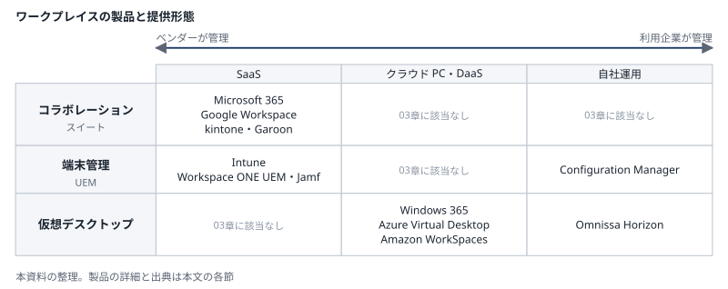

# 03 ワークプレイスの製品と提供形態

## 要旨

製品は、**コラボレーション基盤**（メール・文書・会議）、**端末管理（UEM）**、**仮想デスクトップ・クラウド PC** の3つに分かれる。コラボレーション基盤は Microsoft 365 と Google Workspace の2つが主な選択肢で、国内ではサイボウズの kintone なども広く使われている。2025〜2026年に、両社とも生成 AI の機能をスイートに含めて値上げした（Google は2025年3月、Microsoft は2026年7月）。端末管理は Microsoft Intune と Omnissa Workspace ONE などが中心である。どの領域でも提供形態の主流は SaaS で、Microsoft の製品はスイートのライセンスに含まれるため、**すでに払っている範囲で何が使えるか**が選定の出発点になる（→ 04章）。

*図1　ワークプレイスの製品と提供形態（縦は製品の区分、横は提供形態。本資料の整理）*

## コラボレーション基盤

| | **Microsoft 365** | **Google Workspace** |
|---|---|---|
| 提供元 | Microsoft | Google |
| 成り立ち | 2020年4月に Office 365 の多くのプランを Microsoft 365 に改称 | 2006年に Gmail for Your Domain として始まり、Google Apps、G Suite（2016年）を経て、2020年10月に Google Workspace に改称 |
| 主な構成 | Word・Excel・PowerPoint・Outlook・Teams・SharePoint・OneDrive | Gmail・カレンダー・ドライブ・ドキュメント・スプレッドシート・スライド・Meet |
| 課金の単位と主な版 | 1ユーザー月額。中小企業向けの Business（Basic・Standard・Premium）、大企業向けの Enterprise（Office 365 E1/E3/E5、Microsoft 365 E3/E5）、現場向けの Frontline（F1/F3） | 1ユーザー月額。Business（Starter・Standard・Plus、上限300ユーザー）と Enterprise |
| 価格の改定 | 2026年7月1日から改定。年契約の表示価格で Office 365 E3 は23ドルから26ドル、Microsoft 365 E3 は36ドルから39ドル、E5 は57ドルから60ドル。既存の顧客は次の更新から | 2025年1月に Gemini を Business・Enterprise の各プランに含めて改定。年契約で Business Standard は12ドルから14ドル。既存の顧客は2025年3月17日以降の更新から |
| ライセンスの注意 | 2024年4月以降、新規の企業向け（E1/E3/E5）は Teams を含まない版と Teams 単体を組み合わせる | Gemini を使わない場合の割り引きはなく、全員が AI を含む価格になる |
| 生成 AI | Microsoft 365 Copilot（追加ライセンス、一般提供時は1ユーザー月額30ドル）。Copilot Chat はスイートに含まれる | Gemini を各プランに含める。以前は Gemini のアドオン（1ユーザー月額20ドル以上）が必要だった |

## 端末管理（UEM）

Gartner は2026年から、この市場の Magic Quadrant を「Endpoint Management Tools」として出している。初回の2026年版（2026-01-05）では、Microsoft・Omnissa・Tanium・Jamf・NinjaOne がリーダーとされた（各社の発表）。評価の対象には Google・HCLSoftware・IBM・Ivanti・ManageEngine なども含まれる。

| 製品 | 提供元 | 補足 |
|---|---|---|
| Microsoft Intune | Microsoft | Configuration Manager と合わせて Microsoft Endpoint Manager として提供されてきた。2026年版でリーダー。Microsoft 365 E3/E5 などに含まれ、2026年7月の改定で Remote Help・Advanced Analytics・Intune Plan 2 が E3/E5 に加わった |
| Workspace ONE UEM | Omnissa | 以前は VMware の製品。2026年版でリーダー |
| Tanium | Tanium | 2026年版でリーダー、「ビジョンの完全性」でもっとも高い位置（同社の発表）。Intune との連携の機能を出している |
| Jamf Pro | Jamf | Apple の端末に特化した管理。2026年版でリーダー |
| ManageEngine Endpoint Central | ManageEngine | 2026年版の評価の対象（位置は本資料では未確認）。Gartner Peer Insights の評価数が多い |
| Ivanti Neurons for UEM | Ivanti | 2022年の UEM の Magic Quadrant でリーダー。2026年版の評価の対象（位置は本資料では未確認） |
| IBM MaaS360 | IBM | SaaS の UEM。2026年版の評価の対象（位置は本資料では未確認） |

課金は、1端末または1ユーザーあたりの月額が一般的である（本資料の整理）。

## 仮想デスクトップ・クラウド PC

Gartner の Desktop as a Service の Magic Quadrant 2025年版（2025-08-11）では、AWS・Microsoft・Citrix・Omnissa がリーダーとされた。2026年版（2026-08-05）は AWS・Microsoft・Citrix・Omnissa など13社を評価し、AWS と Omnissa（4年連続）はリーダーと発表している。2026年版の Microsoft と Citrix の位置は本資料では未確認である。

| 製品 | 提供元 | 補足 |
|---|---|---|
| Windows 365 | Microsoft | クラウド PC。2021年8月に一般提供。Business と Enterprise の2つの版。Windows 365 で Windows 11 を使う場合、手元の Windows 10 端末の ESU は追加費用なしで提供される |
| Azure Virtual Desktop | Microsoft | クラウド上の VDI。Windows 365 の基盤。Microsoft は2025年版の DaaS の評価でリーダー |
| Omnissa Horizon | Omnissa | 2023〜2026年版でリーダー。オンプレミス、Microsoft・Amazon のクラウド、その組み合わせのどこにも置け、管理はクラウドの画面に集める |
| Citrix DaaS | Citrix | 2025年版でリーダー。Amazon WorkSpaces Core などの他社の基盤の上でも動く |
| Amazon WorkSpaces | AWS | 2025・2026年版でリーダー。2026年に AI エージェント向けの WorkSpaces を出し、2026年版で初めて評価された |

## 国内の製品

| 製品 | 提供元 | 補足 |
|---|---|---|
| kintone | サイボウズ | ノーコードの業務アプリの基盤。2025年末時点で国内3万9,000社が導入し、東証プライム上場企業の約46%が使う（同社の決算説明資料）。開発の基盤としては app-development 03章も参照 |
| Garoon | サイボウズ | 中堅・大企業向けのグループウェア。2025年末時点で8,400社 |
| サイボウズ Office | サイボウズ | 中小企業向けのグループウェア。2025年末時点で8万3,000社 |

いずれも SaaS が中心で、1ユーザー月額の課金である。メールの機能は含まないため、Microsoft 365 や Google Workspace と組み合わせて使う例が多い（本資料の整理）。

## 他の製品に付属する機能

| 付属する先 | 機能 | 補足（本資料の整理） |
|---|---|---|
| Microsoft 365 E3/E5、Business Premium | Intune（端末管理）、Entra ID（→ identity 03章）、Defender（→ security-operations 03章） | 別の製品を買わなくても、ライセンスの範囲で端末管理と ID 管理が使える |
| Microsoft 365 の各プラン | Copilot Chat | 2026年7月の改定で機能が広がった |
| Google Workspace の各プラン | Gemini、端末管理の基本機能 | 2025年の改定で Gemini を含めた |

## 提供形態

| 形態 | ベンダーが管理するもの | 利用企業が管理するもの | 例 |
|---|---|---|---|
| SaaS（スイート） | 基盤、アプリの更新、データの保管 | 利用者とライセンス、権限・共有の設定、データの保持と削除の方針 | Microsoft 365、Google Workspace、kintone |
| SaaS（端末管理） | 管理の基盤とエージェントの更新 | 端末の登録、構成のポリシー、配布するアプリ | Intune、Workspace ONE UEM |
| クラウド PC・DaaS | 仮想デスクトップの基盤 | OS のイメージ、アプリ、利用者の割り当て | Windows 365、Amazon WorkSpaces |
| 自社運用の VDI・端末管理 | ソフトウェアの提供と保守 | 上記に加えて、サーバと基盤の運用 | Omnissa Horizon のオンプレミス版、Configuration Manager |

スイートの SaaS では、**機能の追加と価格の改定をベンダーが決める**。利用企業が選べるのは、版と契約の時期である（本資料の整理）。

## 市場の動き

| 時期 | できごと |
|---|---|
| 2020年4月 | Microsoft が Office 365 の多くのプランを Microsoft 365 に改称した |
| 2020年10月 | Google が G Suite を Google Workspace に改称した |
| 2023年11月1日 | Microsoft 365 Copilot が企業向けに一般提供された |
| 2024年4月1日 | Microsoft が新規の企業向けのスイートから Teams を切り離した |
| 2024年7月1日 | KKR が Broadcom から VMware のエンドユーザーコンピューティング事業を約40億ドルで買い、Omnissa として独立させた |
| 2025年3月17日 | Google Workspace の Gemini を含めた新価格が、既存の顧客の更新に適用され始めた |
| 2026年1月5日 | Gartner が Endpoint Management Tools の Magic Quadrant を初めて出した |
| 2026年7月1日 | Microsoft 365 の商用スイートの価格を改定した |
| 2026年8月5日 | Gartner が Desktop as a Service の Magic Quadrant 2026年版を出した |

## 本資料でまだ扱っていないもの

- PC のハードウェアと調達の形態（購入・リース・Device as a Service）
- スマートフォンの業務利用の形態（会社支給・私物の業務利用）
- Slack・Zoom・LINE WORKS などの、スイート以外のコラボレーション製品
- Microsoft 365 と Google Workspace の、Gartner などの第三者による比較の評価

---

**出典**（確認日：2026-11-14）

- Microsoft 365 への改称：Computerworld — https://www.computerworld.com/article/1616773/microsoft-to-shift-smbs-office-subscriptions-to-microsoft-365-brand.html
- Google Workspace の沿革：Wikipedia「Google Workspace」— https://wikipedia.com/wiki/Google_Apps 、Google Workspace Updates（2020-10-06）— https://workspaceupdates.googleblog.com/2020/10/introducing-google-workspace.html
- Teams の切り離し：Microsoft Tech Community（2024-04-01）— https://techcommunity.microsoft.com/t5/partner-news/important-notice-changes-to-microsoft-365-office-365-and/ba-p/4100985
- Microsoft 365 の2026年7月の価格と内容の改定：Microsoft Licensing（2026-02-16）— https://www.microsoft.com/licensing/news/2026-M365-Packaging-Pricing-Updates 、Microsoft 365 ブログ（2025-12-04）— https://microsoft.com/en-us/microsoft-365/blog/2025/12/04/advancing-microsoft-365-new-capabilities-and-pricing-update 、Office Watch（改定前後の価格表）— https://office-watch.com/2025/microsoft-365-price-increase-2026/
- Google Workspace の2025年の改定：9to5Google（2025-01-15）— https://9to5google.com/2025/01/15/google-workspace-price-increase-2025/ 、TechRepublic — https://www.techrepublic.com/article/google-workspace-gemini-pricing-plans/ 、Redress Compliance（Gemini を使わない場合の扱い）— https://redresscompliance.com/gemini-google-workspace-licensing-whats-included.html
- Copilot と Duet AI の価格：Computing（2023-09）— https://computing.co.uk/news/4127742/microsoft-launch-365-copilot-enterprise 、TechRadar — https://techradar.com/pro/microsoft-365-copilot-is-generally-available-now-but-theres-an-expensive-hitch
- Endpoint Management Tools の Magic Quadrant 2026年版（2026-01-05）：Gartner の要約（評価の対象）— https://www.gartner.com/en/documents/7298830 、Omnissa（2026-01-15）— https://www.businesswire.com/news/home/20260115417978/en/ 、Tanium（2026-01-08）— https://www.tanium.com/press-releases/tanium-named-a-leader-in-the-2026-gartner-magic-quadrant-for-endpoint-management-tools-2 、Jamf — https://www.jamf.com/blog/jamf-leader-gartner-magic-quadrant-endpoint-management-2026/ 、NinjaOne — https://ninjaone.com/blog/leader-2026-gartner-magic-quadrant-mq 、Microsoft Intune の位置：Anoop C Nair — https://www.anoopcnair.com/strength-microsoft-intune-by-gartner-for-2026/
- UEM の Magic Quadrant（2020・2022）：MobileCorp — https://www.mobilecorp.com.au/learning-hub/microsoft-and-vmware-then-daylight-in-uem-gartner-magic-quadrant-2020 、https://www.mobilecorp.com.au/blog/microsoft-vmware-ivanti-only-uem-leaders-in-2022-says-gartner
- UEM の製品一覧：Gartner Peer Insights — https://www.gartner.com/reviews/market/unified-endpoint-management-tools/vendor/omnissa/product/workspace-one-uem
- Omnissa の独立：Omnissa（2024-07-01）— https://www.omnissa.com/official-launch-pr 、O'Melveny（約40億ドルの取引の発表）— https://www.omm.com
- Desktop as a Service の Magic Quadrant：2025年版（2025-08-11）の Gartner の要約 — https://www.gartner.com/en/documents/6828434 、2025年版のリーダー：Dutch IT Channel（2025-08-20）— https://www.dutchitchannel.nl/research/691757/aws-en-microsoft-leiders-in-groeiende-daas-markt 、2026年版（2026-08-05）の評価の対象：Gartner — https://www.gartner.com/en/documents/8217761 、AWS — https://aws.amazon.com/blogs/desktop-and-application-streaming/aws-and-amazon-workspaces-recognized-as-a-leader-in-the-2026-gartner-magic-quadrant-for-desktop-as-a-service/ 、Omnissa（4年連続、Horizon Cloud の配置）— https://www.omnissa.com/insights/Omnissa-Gartner-Magic-Quadrant-DaaS-2026-press-release/ 、Citrix と Amazon WorkSpaces Core：XTIUM（Gartner Critical Capabilities の転載）— https://xtium.com/gartner-critical-capabilities-for-desktop-as-a-service-full
- Windows 365：Microsoft 365 ブログ — https://www.microsoft.com/en-us/microsoft-365/blog/?p=237041 、ESU の扱い：Petri — https://petri.com/?p=762768
- サイボウズの導入社数：サイボウズ 2025年12月期 決算説明資料 — https://cybozu.co.jp/company/ir/meeting/pdf/2512_03.pdf 、EDINET DB — https://edinetdb.jp/company/E05116
- 課金の単位の一般化、付属する機能の表、提供形態の表は本資料の整理
- 製品の区分は 2026-11 時点の各社の公表情報による。契約の判断の前には各社の最新の資料で確かめる
