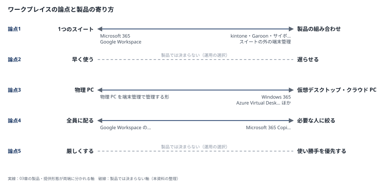

# 04 ワークプレイスの主要な論点

## 要旨

ワークプレイスを扱うときに出てくる軸は次の5つである（本資料の整理）。

1. 1つのスイートでそろえるか、製品を組み合わせるか
2. 新しい版を早く使うか、検証してから遅らせるか
3. 端末を物理 PC で配るか、仮想・クラウドで配るか
4. 上位のライセンスを全員に配るか、必要な人に絞るか
5. 端末の管理を厳しくするか、使い勝手を優先するか

*図1　ワークプレイスの論点と製品の寄り方（実線は03章の製品が両端に分かれる軸、破線は製品では決まらない軸。本資料の整理）*

## 論点1：1つのスイートでそろえるか、製品を組み合わせるか

| | 1つのスイート（Microsoft 365 など） | 製品の組み合わせ（Slack、Zoom、他社の端末管理など） |
|---|---|---|
| 得るもの | ID・端末管理・セキュリティ・AI が最初からつながる。契約が1つ | 領域ごとに使いやすい製品を選べる |
| 失うもの | 束の中身と価格はベンダーが決める（Teams の切り離しのように変わる） | 製品間の連携と、重複する費用（スイートにすでに含まれている機能の二重払い） |

**製品・提供形態との対応**（→ 03章）

| | 1つのスイート（Microsoft 365 など）に寄るもの | 製品の組み合わせ（Slack、Zoom、他社の端末管理など）に寄るもの |
|---|---|---|
| 製品・提供形態 | Microsoft 365（Intune・Entra ID・Defender・Copilot Chat を含む）、Google Workspace（Gemini と端末管理の基本機能を含む） | kintone・Garoon・サイボウズ Office、スイートの外の端末管理（Tanium、Jamf Pro、Workspace ONE UEM など） |

典型的な懸念：「同じ機能に二重に払っている」「スイートの値上げに抵抗できない」

## 論点2：新しい版を早く使うか、検証してから遅らせるか

| | 早く使う | 遅らせる |
|---|---|---|
| 得るもの | 新機能（生成 AI など）とセキュリティの改善をすぐに使える | 業務アプリとの互換性を確かめてから展開できる |
| 失うもの | 変更が業務に影響するおそれ | 新機能の提供が遅れる（Copilot は更新チャネルによって提供時期が違った → 02章）。サポート期限が迫ってから慌てる |

**製品・提供形態との対応**（→ 03章）：製品では決まらない（運用の選択）。Microsoft 365 は更新チャネルを選んで、版の展開の早さを決められる

典型的な懸念：「更新のたびに画面が変わる」「サポート期限までに入れ替えが終わらない」

Windows 10 の延長セキュリティ更新は、法人では年ごとに価格が倍になる（→ 02章）。遅らせる費用は、年を追って増える。

## 論点3：端末を物理 PC で配るか、仮想・クラウドで配るか

| | 物理 PC | 仮想デスクトップ・クラウド PC |
|---|---|---|
| 得るもの | ネットワークが不安定でも使える。性能を出しやすい | データが端末に残らない。どの端末からでも同じ環境に入れる。委託先・短期の利用者に配りやすい |
| 失うもの | 紛失時の情報漏えいの対策、ハードウェアの更新の手間 | ネットワークに依存する。月額の費用が続く |

**製品・提供形態との対応**（→ 03章）

| | 物理 PCに寄るもの | 仮想デスクトップ・クラウド PCに寄るもの |
|---|---|---|
| 製品・提供形態 | 物理 PC を端末管理（Intune、Workspace ONE UEM、Jamf Pro など）で管理する形 | Windows 365、Azure Virtual Desktop、Omnissa Horizon、Citrix DaaS、Amazon WorkSpaces |

## 論点4：上位のライセンスを全員に配るか、必要な人に絞るか

| | 全員に配る | 必要な人に絞る |
|---|---|---|
| 得るもの | 管理が単純。誰でも同じ機能を使える | 費用を抑えられる |
| 失うもの | 使われない機能に払う | 誰に何が必要かを決め、見直し続ける手間。人によって使える機能が違う |

**製品・提供形態との対応**（→ 03章）

| | 全員に配るに寄るもの | 必要な人に絞るに寄るもの |
|---|---|---|
| 製品・提供形態 | Google Workspace の Gemini。全プランに含まれ、使わない場合の割り引きがない | Microsoft 365 Copilot。追加ライセンスのため、人を選んで配れる |

典型的な懸念：「E5 の機能を使い切れていない」「Copilot を全員に配る価値があるか」

## 論点5：端末の管理を厳しくするか、使い勝手を優先するか

| | 厳しくする | 使い勝手を優先する |
|---|---|---|
| 得るもの | 管理されていない端末からの情報漏えいを防げる | 社員が私物や好きな端末で仕事ができる |
| 失うもの | 社員の不満、例外の申請が増える | 端末の状態が分からず、条件付きアクセスで判断できない |

**製品・提供形態との対応**（→ 03章）：製品では決まらない（運用の選択）。どの端末管理の製品も、厳しい設定と緩い設定の両方を作れる

---

**出典**（確認日：2026-11-14）

- 5つの軸と各表の内容は、01〜03章をもとにした本資料の整理
- 各論点の「製品・提供形態との対応」は、03章の製品をもとにした本資料の整理
