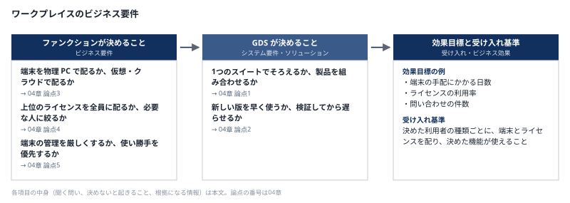

# 05 ワークプレイスのビジネス要件

## 要旨

ワークプレイスの製品を選ぶ前に、ファンクションには**どの働き方（場所・端末・使う機能）を認めるか**を決めてもらう。端末の管理の厳しさとライセンスの配り方は、その働き方で決まる。

この章は、governance/budget-transfer の kickoff 資料（IT 予算移管の要点）にある役割分担を、この技術について具体化したものである。

*図1　ワークプレイスのビジネス要件（ファンクションが決めたビジネス要件をもとに GDS がシステム要件とソリューションを決め、効果目標と受け入れ基準で確かめる）*

## ファンクションが決めること（ビジネス要件）

### 端末を物理 PC で配るか、仮想・クラウドで配るか

- **決めること**：端末の配り方（→ 04章 論点3）
- **聞く問い**：「委託先・短期の利用者・在宅の社員に、どの端末で仕事をさせるか」
- **決めないと起きること**：すべてに物理 PC を配り、委託先や短期の利用者の管理が漏れる
- **根拠になる情報**：利用者の種類と人数、働く場所

### 上位のライセンスを全員に配るか、必要な人に絞るか

- **決めること**：上位のライセンス・AI を配る人（→ 04章 論点4）
- **聞く問い**：「生成 AI・上位の機能を、どの業務の人に使わせたいか」
- **決めないと起きること**：全員に配って使われない費用が出る、または必要な人に届かない
- **根拠になる情報**：業務ごとの利用の見込み、効果の測り方

### 端末の管理を厳しくするか、使い勝手を優先するか

- **決めること**：私物の端末での業務を認めるか（→ 04章 論点5）
- **聞く問い**：「私物のスマートフォンで、メールや会議を使わせるか」
- **決めないと起きること**：認めるかが決まらないまま、管理されていない端末からの接続が増える
- **根拠になる情報**：社内の規程、業務上の必要

## GDS が決めること

- 1つのスイートでそろえるか、製品を組み合わせるか（→ 04章 論点1）
- 新しい版を早く使うか、検証してから遅らせるか（→ 04章 論点2）

## 効果目標と受け入れ基準

- **効果目標の例**：端末の手配にかかる日数、ライセンスの利用率、問い合わせの件数
- **受け入れ基準**：決めた利用者の種類ごとに、端末とライセンスを配り、決めた機能が使えること

## 部門に閉じた案件として扱えないとき

- 全社員が利用者になる
- ID・アクセス管理とセキュリティ運用の設定に関わる

境界の詳細（どのシステムが何を持つか）は [function-allocation](../../../cross-cutting/function-allocation/function-allocation.md) を参照。

---

**出典**（確認日：2026-11-15）

- 役割分担の原則と4つの場面：governance/budget-transfer の kickoff 資料（IT 予算移管の要点、2026-11-02 初版）
- 項目の立て方、問い、例は、04章の論点をもとにした本資料の整理
