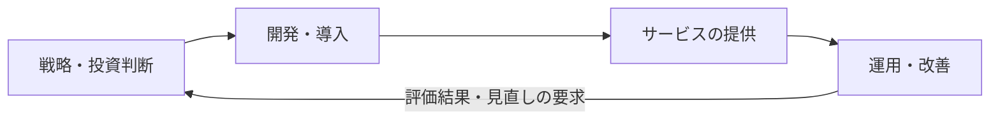
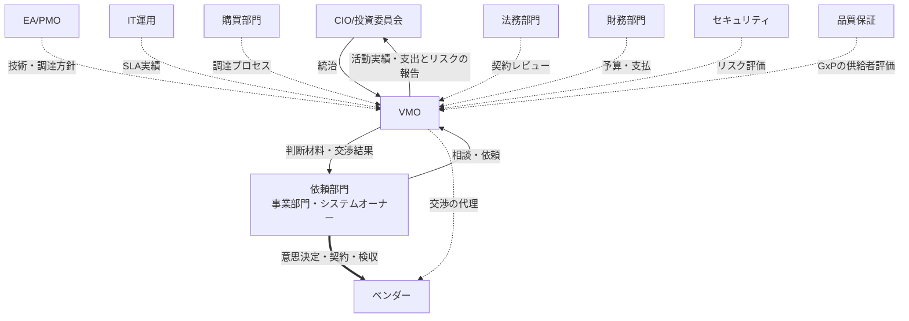

# 第1章：VMOの定義

> 本章は、VMO担当者だけでなく、VMOと関わるすべてのIT組織メンバーに向けたものである。VMOが何を担い、何を担わないか、ITのライフサイクルのどこで関わり、どの情報に責任を持つかを示す。VMOをどう導入するかは第2章、VMOの役割と相談への応じ方は第3章、予算起点の働きかけは第4章で扱う。
>
> 本ガイドでは、VMOに相談する人を**相談者**、相談者が属し、委託先と契約して業務を進める部門を**依頼部門**（事業部門・システムオーナー）と呼ぶ。

## 1.1 VMOとは

VMO（Vendor Management Office）は、IT組織において、**ITの委託先・調達先との取引を、選定・契約から評価・監督まで支える機能**である。

> **VMOは、ベンダーとの取引において依頼部門の代理人として動く専門機能である。** 組織横断の情報（ベンダー情報、契約情報、相場・交渉実績）を維持し、個別の案件では依頼部門に代わって調査・設計・交渉を行う。**意思決定は依頼部門に残る。**

VMOは、ベンダー対応を依頼部門から引き取って一元管理する立場をとらない。依頼部門が主導権を持ったまま、交渉力と専門性を上乗せする「エージェント型（伴走型サービス）」として価値を届ける。この形を選ぶ理由は第2章で示す。

 

## 1.2 VMOが担う仕事と、担わない仕事

### 1.2.1 担う仕事

| 区分 | 仕事 | 内容 |
|---|---|---|
| 委託先の選定と契約 | 選択肢と相場の調査 | 市場にある製品・サービスの選択肢と費用レンジを、前提条件つきで示す |
| | 選定の準備 | 評価基準、RFP／見積依頼、提案の比較表 |
| | 契約条件の設計 | SOW・SLA・出口条項の設計と、契約リスクの洗い出し |
| | 交渉の代行 | 価格・条件の交渉を、依頼部門の代理人として引き受ける |
| 委託先の評価と監督 | 定期評価 | 品質・SLA実績・コストを評価し、記録する |
| | 是正と価格協議 | SLA未達時の改善要求、値上げ要請への対応 |
| | 見直しと終了 | 体制の見直し、継続か切替かの判断材料づくり、契約終了の段取り |
| 基盤業務 | ベンダー情報・契約情報の維持 | 全ITベンダー・SaaSの契約、満了日、解約通知期限を一元管理する |
| | 相場・交渉実績の蓄積 | 案件ごとの単価・条件・交渉結果を、次の案件で使える形で残す |
| | 契約更新期限の管理と声がけ | 解約通知期限から逆算し、相談を待たずに依頼部門へ働きかける |

 

### 1.2.2 担わない仕事（隣接する機能との境目）

VMOの仕事と隣り合い、混同されやすい仕事を次に示す。いずれもVMOは情報を提供し、相談に応じるが、担い手ではない。

| 仕事 | 担い手 | VMOとの境目 |
|---|---|---|
| 委託先の作業の監督（進捗・品質・成果物） | プロジェクト管理（依頼部門のPM） | VMOは作業範囲・成果物・検収条件を契約に書くところまで。日々の作業の監督はPMが行う |
| サービスレベル実績の日常測定 | IT運用（ITサービスマネージャー） | VMOは実績データを受け取り、契約上の評価と是正交渉に使う |
| ライセンス・SaaSの割当と利用状況の把握 | IT資産管理 | VMOは利用状況を受け取り、契約数量の見直しと交渉に使う |
| 予算の承認・投資案件の決定 | 財務部門、投資判断の会議体 | VMOは根拠のある予算見積と相場情報を提供する |
| 法令の解釈・契約書の法的審査 | 法務部門 | VMOは論点を事前に整理して法務レビューに渡す |
| セキュリティ・品質の最終判断 | セキュリティ部門、品質保証（QA） | VMOは評価基準と契約条項に組み込む |

 

---

## 1.3 ITのライフサイクルとVMOの関わり

### 1.3.1 4つの段階と、VMOが関わる場面

ITは、戦略と投資判断から始まり、開発・導入、サービスの提供、運用と改善を経て、次の投資判断に戻る。VMOは、このうち**委託先・調達先との取引が生じる場面**に関わる。

| ITのライフサイクル | VMOが関わる場面 | 関わり方 |
|---|---|---|
| 戦略・投資判断 | 構想段階で、選択肢と費用感を整理する | 投資判断の材料（費用レンジ、前提条件）を出す |
| 開発・導入 | 委託先を選定し、契約する。成果物を検収する | 選定・契約は中心となって支える。検収は依頼部門を支援する |
| サービスの提供 | サービスレベルと利用条件を合意する | 合意内容を契約条件として設計する |
| 運用・改善 | 委託先を評価・監督し、価格を協議する。契約を見直し、終了する | 評価と是正交渉は中心となって支える。評価結果は次の投資判断の材料になる |

運用・改善の段階で生まれる評価結果（品質への不満、値上げ、体制の過不足、継続か切替か、廃止）は、次の投資判断とポートフォリオの見直しに戻っていく。VMOはこの戻りの流れを、ベンダーとの取引の面から支える。

 

### 1.3.2 依頼部門から見たVMO：4フェーズと11の相談の入口

依頼部門から見れば、VMOの関わりは、案件の4つのフェーズにわたる**相談の入口**として現れる。

| フェーズ | VMOが担う機能 | 相談の入口（相談者の言葉） |
|---|---|---|
| ① 探索 | 製品・ベンダーが未確定の段階から、選択肢と費用感を整理する | ・どんな選択肢があるのか、相場感を知りたい |
| ② 選定・契約 | RFP／見積依頼の準備、契約条件の設計、ベンダーとの交渉、検収の支援を行う | ・RFP・見積依頼の準備を手伝ってほしい ・もう決まっている案件を、契約前に確認したい ・契約条件をどう詰めればいいか分からない |
| ③ 運用・改善 | 稼働後の品質・コスト・予算を継続的に確認し、改善や価格交渉に対応する | ・ベンダーの対応品質に納得がいかない ・ベンダーから値上げを要請された ・来年度の予算をどう積めばいいか分からない ・契約が入り組んで、全体が見えない |
| ④ 見直し・転換 | 体制の増強・縮小、乗り換え、契約終了など、次の姿に合わせて契約を組み替える | ・いまの体制が実態に合っていない ・いまのベンダーを続けるべきか迷っている ・システムの縮小・廃止を控えている |

相談は業務プロセスの順番ではなく、依頼部門が困った順番でやってくる。そのため第3章の実務は、この相談の入口ごとに整理している。

 

---

## 1.4 VMOが作り、守る情報

### 1.4.1 VMOが維持する情報

VMOの価値は、個別の案件の対応だけでなく、案件を重ねるごとに蓄積される情報から生まれる。VMOが維持に責任を持つ情報を次に示す。

| 情報 | 内容 | 主な使い道 |
|---|---|---|
| ベンダー情報 | 委託先・SaaS事業者の名称、取引の区分（取適法の対象か）、担当範囲、Tier（取引額×重要度、1.4.2） | 手のかけ方とベンダーとの接点の決定 |
| 契約情報 | 契約形態（請負・準委任など）、作業範囲、金額、期間、更新方式、**解約通知期限**、SLA | 更新期限の管理、値上げ検証、契約の整理 |
| 検収記録 | 委託先の成果物の検査結果と検収日（依頼部門が作成し、VMOが契約に紐づけて保管する） | 支払条件の確認、委託先の評価 |
| ベンダー評価記録 | 品質・SLA実績・コストの評価結果。GxPに関わる委託先は、依頼部門と品質保証が行った評価・監査の結果も紐づける | 是正交渉、継続か切替かの判断 |
| 相場・交渉実績 | 単価・数量とその前提、当初提示と着地の差分、有効だった交渉論点 | 相場の提示、交渉余地の見積もり |
| 案件記録 | 相談の内容とフェーズ、対応経過、所要期間 | 次の相談への再利用、VMOの成果の可視化 |

契約、検収記録、ベンダー評価記録は、取適法上の取引記録やGxPの供給者評価の証跡を兼ねることがある。**記録を作成し、法令上の保存義務を負うのは依頼部門**であり、VMOはそれらを契約とベンダーに紐づけて、組織として参照できる状態に保つ（1.7）。

これらの情報は、VMO担当者個人ではなくVMOの資産として保持する。担当が変わっても引き継げる形で保つことは、VMOの基盤業務そのものである（第3章 3.3）。

### 1.4.2 ベンダーのTier

ベンダーを、取引額と重要度の2軸で4つのTierに分ける。

| 軸 | 区分 | 判定の基準 |
|---|---|---|
| 取引額 | 大／小 | 直近年度の取引実績を金額の大きい順に並べ、上位からの累計が全体の8割に達するまでのベンダーを「大」、それ以外を「小」とする |
| 重要度 | 高／低 | 次の2つのうち、少なくとも一方が重要であれば「高」とする。**事業重要度**：ベンダーが担う領域が、売上（トップライン）または利益（ボトムライン）に直接影響する度合い。**業務重要度**：ベンダーが担うIT業務の、業務領域に対するカバレッジ。単一のフェーズだけを担うより、設計・開発・テストなど複数のフェーズを網羅して担う方が重要 |

| Tier | 取引額 | 重要度 | ベンダーとの接点 | 時期 |
|---|---|---|---|---|
| Tier1 | 大 | 高 | 来期に向けた会議を行い、中長期の提案を受ける | 年次（予算がある程度決まった時点） |
| Tier2 | 小 | 高 | パフォーマンス評価と関係者ヒアリングを行い、その結果をフィードバックして次回の取引や契約更新に活かす | 既存契約の更新時、または参画しているプロジェクトの終了時 |
| Tier3 | 大 | 低（または契約の終期が確定している） | 接点は特に設けない。可能であれば、Tier1・Tier2のベンダー、または他のTier3のベンダーへの統合を、調達部門・IT担当者と協議する | 年次 |
| Tier4 | 小 | 低 | 他のTierへ移す余地がなければ、他のTierのベンダーに巻き取ってもらうことを、調達部門・IT担当者と協議する | 年次の棚卸しと、契約が見つかった時点で随時協議し、四半期ごとに決定する |

ベンダーへの依存度は、Tierの判定には使わない。依存度が高いほどVMOが打てる手は限られるため、Tierごとの打ち手の幅を決める条件として、Tierとは別に評価する。

ベンダー戦略は年次で、予算がある程度決まった時点で立てる。Tierもこのときに判定し直す（第3章 3.3）。来年度の予算を起点にVMOから働きかける活動は、第4章で扱う。

> **注**：ベンダーのTier分類・評価は、格付けして統制するために行うのではない。**手のかけ方とベンダーとの接点を決めるため**に行う。分類の結果として管理を強めるのはVMO自身の作業量であって、依頼部門の裁量ではない。

 

---

## 1.5 他のIT機能との役割と責任

### 1.5.1 組織上の位置づけ

エージェント型では、VMOはベンダーと依頼部門の間に**代理人として**立つ。ベンダーを直接統制する立場ではない。

 

### 1.5.2 案件対応での役割分担（RACI）

個別案件では、**意思決定の最終責任（A）は常に依頼部門にある**。VMOは実行責任（R）を担う。法令上の義務を伴う活動（発注内容の明示、検収、GxPに関わる委託先の評価）も、主体は依頼部門である。

| 活動 | 依頼部門 | VMO | 購買 | 財務 | 法務 | セキュリティ | 品質保証 | EA/PMO | ITサービスMGR |
|---|---|---|---|---|---|---|---|---|---|
| 業務要件の決定 | **A**/R | C | I | I | I | C | C | C | C |
| 選択肢・相場の調査 | **A** | R | C | I | I | I | I | C | I |
| 評価基準の設計 | **A** | R | C | I | I | C | C | C | C |
| RFP／見積依頼の作成・運営 | **A** | R | R | I | C | C | I | C | C |
| ベンダーの選定 | **A**/R | C | C | I | I | C | C | C | C |
| 契約条件・SLAの設計 | **A** | R | C | C | C | C | C | I | C |
| 価格・条件の交渉 | **A** | R | R | C | C | I | I | I | I |
| 契約の締結 | **A** | C | R | C | R | I | I | I | I |
| 発注内容の明示・支払期日の設定 | **A** | C | R | R | C | I | I | I | I |
| 成果物の検収 | **A**/R | C | C | I | I | I | C | I | C |
| 予算確保・社内承認 | **A**/R | C | I | R | I | I | I | I | I |
| SLA/KPIの日常モニタリング | C | C | I | I | I | C | I | I | **A**/R |
| 委託先の定期評価 | **A** | R | C | C | I | C | C | I | C |
| GxPに関わる委託先の評価・監査 | **A** | C | I | I | I | C | R | I | C |
| 改善要求・是正交渉 | **A** | R | C | I | C | C | I | I | R |
| 継続／切替の判断 | **A** | R | C | C | C | I | C | C | C |
| 契約終了・移行の実行 | **A** | R | C | C | C | R | C | I | R |

**凡例**：**A** = Accountable（最終責任）／R = Responsible（実行）／C = Consulted（相談を受ける）／I = Informed（情報共有される）。品質保証の関与は、GxPに関わるシステム・業務の場合に限る。

 

### 1.5.3 A（最終責任）の置き方の原則

> **VMOが「A」を持つのは、自らの基盤業務に限る。** ベンダー情報・契約情報の維持、契約更新期限の管理、相場・交渉実績の蓄積がそれにあたる。個別案件の意思決定——どのベンダーを選ぶか、どの条件で契約するか、検収するか、続けるか乗り換えるか——のAは、常に依頼部門にある。VMOはそこでRを担う。

この線引きが、エージェント型とガバナンス型を分ける実務上の分水嶺である。契約交渉やベンダー評価のAをVMOへ移した時点で、それはガバナンス型であり、第2章 2.4で述べる「育つ間のリスクを事業が負う」構造に変わる。

判断に迷ったときは、次の問いに戻る。**「この決定が誤りだったとき、責任を負うのは誰か」** 答えが依頼部門であれば、Aは依頼部門にある。

 

---

## 1.6 ステークホルダーと、それぞれに対する提供価値

| ステークホルダー | VMOとの関係 | VMOが提供する価値 |
|---|---|---|
| 依頼部門（事業部門・システムオーナー） | 相談者。意思決定の主体 | ベンダー対応にかかる専門知識・交渉力・相場情報を提供し、対応工数と判断の負荷を軽減する。判断は依頼部門に残したまま、成果の水準を引き上げる |
| CIO／投資委員会 | 統治・承認 | 全社のITベンダー支出とリスクの一元的な可視化、投資判断に資する情報提供、重大リスクの早期把握 |
| EA/PMO | 調達方針を受け取る | 技術戦略・アーキテクチャ方針に沿った調達の実行。方針の意図をベンダー選定・契約条件に反映する |
| IT運用（ITサービスマネージャー） | 日常のSLA実績を共有 | SLA未達時の是正交渉をVMOが担い、運用チームが技術的対応に専念できる環境をつくる |
| 購買部門 | RFP発行・入札・発注で協働 | IT特有の契約論点（SLA、ライセンス、クラウド契約等）の専門知識を補い、公正な調達プロセスの設計を支援する |
| 法務部門 | 契約レビューで連携 | データ保護・SLA・解約条項・取適法などIT委託に特有の論点を事前に整理し、法務レビューの負荷を軽減する |
| 財務部門 | 予算確保・支払で連携 | 契約条件・相場に基づく精度の高い予算見積を提供し、コスト最適化の効果を可視化する |
| セキュリティ部門 | リスク評価で連携 | ベンダーのセキュリティ体制を契約段階から評価基準に組み込み、監査対応の負荷を軽減する |
| 品質保証（QA） | GxPに関わる委託先の評価で連携 | 品質取決めと評価・監査の観点を契約条件に組み込み、評価記録を契約とベンダーに紐づけて参照できるようにする |
| 各ベンダー | 取引先 | 明確な窓口と一貫した評価基準による公正な取引関係、長期的なパートナーシップの機会を提供する |

 

---

## 1.7 委託取引に関わる法令・規制

ITの委託取引には、契約条件や記録の残し方に直接効く法令・規制がある。**これらの法令上の義務を負い、手続きを行う主体は依頼部門**である（発注は購買部門、支払は財務部門、GxPの評価は品質保証と連携する）。VMOは法令の解釈や判断は行わず、契約条件の設計・点検と記録の維持を通じて、依頼部門が義務を果たせるよう支援する。法令の解釈は法務部門が行う。

| 法令・規制 | 委託取引で求められること | 主体 | VMOの関わり |
|---|---|---|---|
| 取適法（中小受託取引適正化法。2026年1月に下請法から改正） | 対象となる取引では、発注内容（給付の内容・代金・支払期日など）の明示、支払期日の設定、取引記録の作成・保存が求められ、受領拒否・不当な減額・買いたたきなどが禁止される | 依頼部門（発注は購買、支払は財務と連携） | 取引の区分（対象か）をベンダー情報に持つ。契約前の点検で、発注内容と支払条件の明示漏れ、一方的な価格決定になっていないかを確認する |
| 請負と準委任の区別（労働者派遣法） | 請負は成果物の完成、準委任は業務の遂行に責任を負う。いずれの形態でも、発注者が委託先の要員に直接指揮命令すると偽装請負となる | 依頼部門（委託先と日々接する立場） | 契約形態と作業範囲・成果物・検収条件の書き方を点検し、実態と契約形態がずれないようにする |
| GxP（GMP省令の供給者管理、コンピュータ化システムの適正管理） | GxPに関わるシステム・業務の委託先を、品質への影響に応じて評価・監査し、品質に関する取決めを結ぶ | 依頼部門（品質保証と連携） | 評価基準と契約条件に品質取決めを組み込むよう支援し、評価・監査の結果をベンダー評価記録に紐づける |
| 個人情報保護法 | 個人データの取扱いを委託する場合、委託先を監督する | 依頼部門 | データ保護の契約要件を点検する（付録E） |

場面ごとに見ると、分担は次のとおりである。

| 場面 | 依頼部門が行うこと（主体） | VMOが行うこと（支援） |
|---|---|---|
| 発注・契約締結 | 発注内容（給付の内容・代金・支払期日など）を明示する（購買部門と連携） | 取引の区分（取適法の対象か）をベンダー情報に持ち、明示漏れがないかを契約前に点検する |
| 契約形態の選択と日々の運用 | 実態に合った契約形態（請負・準委任）を選び、委託先の要員に直接指揮命令しない | 作業範囲・成果物・検収条件が契約形態と矛盾しない書き方になっているかを点検する |
| 検収 | 成果物を検査して検収し、記録を作成・保存する | 検収条件を契約に明記し、検収記録を契約に紐づけて残す。支払期日との関係を示す |
| 価格の改定・減額 | 委託先と協議して決める。一方的な減額や価格決定をしない | 交渉の経過と合意内容を記録に残す |
| GxPに関わる委託先 | 品質保証と連携して委託先を評価・監査し、品質取決めを結ぶ | 評価基準と契約条件に品質取決めを組み込み、評価・監査の結果をベンダー評価記録に紐づける |
| 個人データの取扱いの委託 | 委託先を監督する | データ保護の契約要件を点検する（付録E） |

> 検収は、取適法上の受領や支払期日、請負契約の完成の確認と結びつく行為である。**検収の判断と記録の作成は依頼部門が行い**、VMOは検収条件を契約に明記し、検収記録を契約に紐づけて残す。
