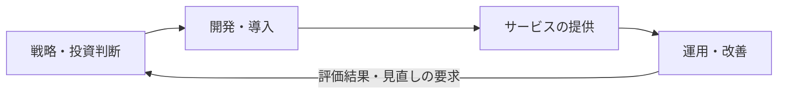
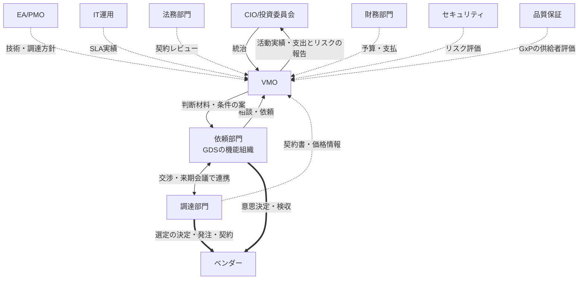

# 第1章：VMOの定義

> 本章は、VMO担当者だけでなく、VMOと関わるすべてのIT組織メンバーに向けたものである。VMOが何を担い、何を担わないか、ITのライフサイクルのどこで関わり、どの情報に責任を持つかを示す。VMOをどう導入するかは第2章、VMOの役割と相談への応じ方は第3章、予算起点の働きかけは第4章で扱う。
>
> 本ガイドでは、VMOに相談する人を**相談者**、相談者が属し、ベンダーと取引して業務を進めるGDSの機能組織（インフラ、セキュリティ、ビジネスアプリなど）を**依頼部門**と呼ぶ。依頼部門では、案件の担当者（システムオーナー・担当BP）と予算責任者が意思決定する。

## 1.1 VMOとは

**ベンダーマネジメント**は、ベンダーとの関係と契約を、選定から監視まで一貫して管理する機能である。当社が独自に考えた仕組みではなく、IT組織の標準的なフレームワークに定められている。

| フレームワーク | 定め | 内容 |
|---|---|---|
| ITIL 4（AXELOS） | プラクティス「Supplier management」 | サプライヤーとそのパフォーマンスを適切に管理し、質の高い製品・サービスの提供を支える。主要なサプライヤーとはより協力的な関係を築き、新たな価値を引き出し、失敗のリスクを減らす |
| COBIT 2019（ISACA） | 管理目標「APO10 Managed Vendors」 | 関係と契約の特定・評価、ベンダーの選定、関係と契約の管理、ベンダーのリスク管理、パフォーマンスと遵守状況の監視 |

VMO（Vendor Management Office）は、ベンダーマネジメントを担う組織である。形は、組織に合わせて選ぶ。

| 形 | 内容 |
|---|---|
| 集中型 | 1つの部門が、全社のベンダー管理を一手に担う |
| 分散型 | 各部門が、それぞれのベンダーを個別に管理する |
| 連携型 | 中核の部門と各領域が、役割を分けて担う |

**当社は連携型をとる。** 会社としては、調達部門がベンダーマネジメントの中核を担う。GDSでは、インフラ、セキュリティ、ビジネスアプリといった機能組織が、それぞれベンダーとの実務を行っている。GDSはITの専門組織であり、ベンダーマネジメントも機能組織ごとに専門化が進んでいる。専門性が高く、知識が深くなるほど、個別の最適だけでなく、全体をバランスする機能が要る。GDSのVMOはその役割を担い、各機能組織の実務を束ね、機能組織どうし、そして調達部門とをつなぐ。

> **VMOは、判断の材料になる情報をGDS全体から集めて返す機能である。** ベンダー情報・契約情報、相場・交渉実績を維持し、個別の案件では台帳・Tierの案・過去の実績・条件の案を通じて依頼部門を支える。**VMOは決裁権を持たないのはもちろん、通らなければならない関門としての強制力も一切持たない。** 意思決定は依頼部門に残る。

VMOは、調達部門に代わるものでも、依頼部門の実務を取り上げるものでもない。依頼部門が主導権を持ったまま、交渉力と専門性を上乗せする「エージェント型（伴走型サービス）」として価値を届ける。この形を選ぶ理由は第2章で示す。

 

## 1.2 VMOが担う仕事と、担わない仕事

### 1.2.1 担う仕事

| 区分 | 仕事 | 内容 |
|---|---|---|
| 委託先の選定と契約 | 選択肢と相場の調査 | 市場にある製品・サービスの選択肢と費用レンジを、前提条件つきで示す |
| | 選定の準備 | 評価基準、RFP／見積依頼、提案の比較表 |
| | 契約条件の設計 | SOW・SLA・出口条項の設計と、契約リスクの洗い出し |
| | 交渉の支援 | 交渉の目標、譲れる条件と譲れない条件、条件の案を用意し、依頼部門が調達部門と連携して臨む交渉を支える |
| 委託先の評価と監督 | 定期評価 | 品質・SLA実績・コストを評価し、記録する |
| | 是正と価格協議 | SLA未達時の改善要求と、値上げ要請への対応の材料づくり |
| | 見直しと終了 | 体制の見直し、継続か切替かの判断材料づくり、契約終了の段取り |
| 基盤業務 | ベンダー情報・契約情報の維持 | 全ITベンダー・SaaSの契約、満了日、解約通知期限を一元管理する |
| | 相場・交渉実績の蓄積 | 案件ごとの単価・条件・交渉結果を、次の案件で使える形で残す |
| | 契約更新期限の管理と声がけ | 解約通知期限から逆算し、相談を待たずに依頼部門へ働きかける |

 

### 1.2.2 担わない仕事（隣接する機能との境目）

VMOの仕事と隣り合い、混同されやすい仕事を次に示す。いずれもVMOは情報を提供し、相談に応じるが、担い手ではない。

| 仕事 | 担い手 | VMOとの境目 |
|---|---|---|
| 委託先の作業の監督（進捗・品質・成果物） | プロジェクト管理（依頼部門のPM） | VMOは作業範囲・成果物・検収条件を契約に書くところまで。日々の作業の監督はPMが行う |
| サービスレベル実績の日常測定 | IT運用（ITサービスマネージャー） | VMOは実績データを受け取り、契約上の評価と是正交渉に使う |
| ライセンス・SaaSの割当と利用状況の把握 | IT資産管理 | VMOは利用状況を受け取り、契約数量の見直しと交渉に使う |
| ベンダーの選定（決定）、発注、契約の締結・変更・解約 | 調達部門（購買規程にもとづく） | VMOは台帳・過去の実績・条件の案を提供する |
| 予算の承認・投資案件の決定 | 財務部門、投資判断の会議体 | VMOは根拠のある予算見積と相場情報を提供する |
| 法令の解釈・契約書の法的審査 | 法務部門 | VMOは論点を事前に整理して法務レビューに渡す |
| セキュリティ・品質の最終判断 | セキュリティ部門、品質保証（QA） | VMOは評価基準と契約条項に組み込む |

 

---

## 1.3 ITのライフサイクルとVMOの関わり

### 1.3.1 4つの段階と、VMOが関わる場面

ITは、戦略と投資判断から始まり、開発・導入、サービスの提供、運用と改善を経て、次の投資判断に戻る。VMOは、このうち**委託先・調達先との取引が生じる場面**に関わる。

| ITのライフサイクル | VMOが関わる場面 | 関わり方 |
|---|---|---|
| 戦略・投資判断 | 構想段階で、選択肢と費用感を整理する | 投資判断の材料（費用レンジ、前提条件）を出す |
| 開発・導入 | 委託先を選定し、契約する。成果物を検収する | 選定・契約は中心となって支える。検収は依頼部門を支援する |
| サービスの提供 | サービスレベルと利用条件を合意する | 合意内容を契約条件として設計する |
| 運用・改善 | 委託先を評価・監督し、価格を協議する。契約を見直し、終了する | 評価と是正交渉は中心となって支える。評価結果は次の投資判断の材料になる |

運用・改善の段階で生まれる評価結果（品質への不満、値上げ、体制の過不足、継続か切替か、廃止）は、次の投資判断とポートフォリオの見直しに戻っていく。VMOはこの戻りの流れを、ベンダーとの取引の面から支える。

 

### 1.3.2 依頼部門から見たVMO：4フェーズと11の相談の入口

依頼部門から見れば、VMOの関わりは、案件の4つのフェーズにわたる**相談の入口**として現れる。

| フェーズ | VMOが担う機能 | 相談の入口（相談者の言葉） |
|---|---|---|
| ① 探索 | 製品・ベンダーが未確定の段階から、選択肢と費用感を整理する | ・どんな選択肢があるのか、相場感を知りたい |
| ② 選定・契約 | RFP／見積依頼の準備、契約条件の設計、ベンダーとの交渉、検収の支援を行う | ・RFP・見積依頼の準備を手伝ってほしい ・もう決まっている案件を、契約前に確認したい ・契約条件をどう詰めればいいか分からない |
| ③ 運用・改善 | 稼働後の品質・コスト・予算を継続的に確認し、改善や価格交渉に対応する | ・ベンダーの対応品質に納得がいかない ・ベンダーから値上げを要請された ・来年度の予算をどう積めばいいか分からない ・契約が入り組んで、全体が見えない |
| ④ 見直し・転換 | 体制の増強・縮小、乗り換え、契約終了など、次の姿に合わせて契約を組み替える | ・いまの体制が実態に合っていない ・いまのベンダーを続けるべきか迷っている ・システムの縮小・廃止を控えている |

相談は業務プロセスの順番ではなく、依頼部門が困った順番でやってくる。そのため第3章の実務は、この相談の入口ごとに整理している。

 

---

## 1.4 VMOが作り、守る情報

### 1.4.1 VMOが維持する情報

VMOの価値は、個別の案件の対応だけでなく、案件を重ねるごとに蓄積される情報から生まれる。VMOが維持に責任を持つ情報を次に示す。

| 情報 | 内容 | 主な使い道 |
|---|---|---|
| ベンダー情報 | 委託先・SaaS事業者の名称、取引の区分（取適法の対象か）、担当範囲、Tier（取引額×重要度、1.4.2） | 手のかけ方とベンダーとの接点の決定 |
| 契約情報 | 契約形態（請負・準委任など）、作業範囲、金額、期間、更新方式、**解約通知期限**、SLA | 更新期限の管理、値上げ検証、契約の整理 |
| 検収記録 | 委託先の成果物の検査結果と検収日（依頼部門が作成し、VMOが契約に紐づけて保管する） | 支払条件の確認、委託先の評価 |
| ベンダー評価記録 | 品質・SLA実績・コストの評価結果。GxPに関わる委託先は、依頼部門と品質保証が行った評価・監査の結果も紐づける | 是正交渉、継続か切替かの判断 |
| 相場・交渉実績 | 単価・数量とその前提、当初提示と着地の差分、有効だった交渉論点 | 相場の提示、交渉余地の見積もり |
| 案件記録 | 相談の内容とフェーズ、対応経過、所要期間 | 次の相談への再利用、VMOの成果の可視化 |

契約、検収記録、ベンダー評価記録は、取適法上の取引記録やGxPの供給者評価の証跡を兼ねることがある。**記録を作成し、法令上の保存義務を負うのは依頼部門**であり、VMOはそれらを契約とベンダーに紐づけて、組織として参照できる状態に保つ（1.7）。

いまは、見積のときの契約条件や単価、判断の理由、交渉の経緯が担当者の手元に残り、異動とともに見えなくなっていく。VMOに集まれば、それがGDSの共有財産として積み上がり、一件ごとの共有が次の案件の出発点になる。VMOが入っても進め方は変わらない。変わるのは、取引の情報と知見がGDSの中に積み上がっていくことである。

これらの情報は、VMO担当者個人ではなくVMOの資産として保持する。担当が変わっても引き継げる形で保つことは、VMOの基盤業務そのものである（第3章 3.3）。

### 1.4.2 ベンダーのTier

ベンダーを、取引額と重要度の2軸で4つのTierに分ける。

| 軸 | 区分 | 判定の基準 |
|---|---|---|
| 取引額 | 大／小 | 直近年度の取引実績を金額の大きい順に並べ、上位からの累計が全体の8割に達するまでのベンダーを「大」、それ以外を「小」とする |
| 重要度 | 高／低 | 次の2つのうち、少なくとも一方が重要であれば「高」とする。**事業重要度**：ベンダーが担う領域が、売上（トップライン）または利益（ボトムライン）に直接影響する度合い。**業務重要度**：ベンダーが担うIT業務の、業務領域に対するカバレッジ。単一のフェーズだけを担うより、設計・開発・テストなど複数のフェーズを網羅して担う方が重要 |

| Tier | 取引額 | 重要度 | ベンダーとの接点 | 時期 |
|---|---|---|---|---|
| Tier1 | 大 | 高 | 来期に向けた会議を行い、中長期の提案を受ける | 年次（予算がある程度決まった時点） |
| Tier2 | 小 | 高 | パフォーマンス評価と関係者ヒアリングを行い、その結果をフィードバックして次回の取引や契約更新に活かす | 既存契約の更新時、または参画しているプロジェクトの終了時 |
| Tier3 | 大 | 低（または契約の終期が確定している） | 接点は特に設けない。Tier1・Tier2のベンダー、または他のTier3のベンダーへの統合を協議する。方針はGDSで決め、実施は調達部門と連携する | 年次 |
| Tier4 | 小 | 低 | 他のTierへ移す余地がなければ、他のTierのベンダーに巻き取ってもらうことを随時協議する。方針はGDSで決め、実施は調達部門と連携する | 年次の棚卸しと、契約が見つかった時点で随時協議し、四半期ごとに決定する |

ベンダーへの依存度は、Tierの判定には使わない。依存度が高いほどVMOが打てる手は限られるため、施策を実行できるかどうかの条件として、Tierとは別に評価する（第4章 4.2）。

Tierの案はVMOが用意し、確定はGDS（案件担当・予算責任者）が行う。TierとTierごとの方針はGDSの内部の区分であり、調達部門と合意するものではない。

ベンダー戦略は年次で、予算がある程度決まった時点で立てる。Tierもこのときに判定し直す（第3章 3.3）。来年度の予算を起点にVMOから働きかける活動は、第4章で扱う。

> **注**：Tierはベンダーへの評価ではない。GDSが、どのベンダーにどのくらい力を割くかの濃さである。Tier分類は、格付けして統制するために行うのではない。**手のかけ方とベンダーとの接点を決めるため**に行う。分類の結果として管理を強めるのはVMO自身の作業量であって、依頼部門の裁量ではない。

 

---

## 1.5 他のIT機能との役割と責任

### 1.5.1 組織上の位置づけ

VMOはGDSの一員として、依頼部門と調達部門の両方を下支えする。ベンダーを直接統制する立場でも、ベンダーとの窓口を依頼部門から引き取る立場でもない。

 

### 1.5.2 案件対応での役割分担

個別の案件で誰が何をするかは、VMOが入っても変わらない。

| 担い手 | 行うこと |
|---|---|
| GDS（依頼部門の案件担当・予算責任者） | 業務・技術要件の整理と技術評価／RFP・見積依頼の技術部分の作成／ベンダーの比較と推奨／SLA・品質の評価／Tierの確定とベンダー戦略／Tier3の統合・Tier4の巻き取りの方針／削減目標の設定、予実の分析 |
| GDSと調達部門が連携して行う | Tier1との来期会議／価格・条件の交渉／評価結果のフィードバックと改善の要求／統合・巻き取りの実施／調達部門の契約書・価格情報と台帳の突き合わせ |
| 調達部門（購買規程にもとづいて行う） | RFP・見積依頼の発出と質疑の運営／ベンダーの選定（決定）／条件への合意、発注、契約の締結・変更・解約／SLA未達時のクレジットの合意／値上げ通知への回答 |
| VMO | いずれの活動も、台帳・Tierの案・過去の実績・条件の案を通じて支える |

- 交渉には、GDSが調達部門と連携して臨む。調達部門には必ず事前に共有し、事後報告にはしない。
- 法令上の義務を伴う活動（発注内容の明示、検収、GxPに関わる委託先の評価）の主体は依頼部門である（1.7）。財務・法務・セキュリティ・品質保証などとの境目は1.2.2による。
- 調達部門との分担の詳細は、購買規程の確認を経て1.5.4で確定する。上の表は、そのたたき台である。

 

### 1.5.3 VMOの立ち位置の原則

> **VMOは、RACIでいえば常に「C」の立場にある。** A（最終責任）は、案件の担当者（依頼部門）か調達部門にある。VMOはその両方を下支えする。ベンダー情報・契約情報の維持などの基盤業務はVMO自身の仕事として行うが、それは判断の材料を整える仕事であり、案件や取引を決めることではない。

この線引きが、エージェント型とガバナンス型を分ける実務上の分水嶺である。契約交渉やベンダー評価のAをVMOへ移した時点で、それはガバナンス型であり、第2章 2.4で述べる「育つ間のリスクを事業が負う」構造に変わる。

判断に迷ったときは、次の問いに戻る。**「この決定が誤りだったとき、責任を負うのは誰か」** 答えが依頼部門であれば、Aは依頼部門にある。

 

### 1.5.4 調達部門との役割分担（RACI）

> **【記載予定】** 本節は、購買規程の確認と調達部門との認識合わせを終えてから記載する。確認には `../budget-driven-activity/planning/vmo_purchasing-authority_check.xlsx` を使い、その「RACI（確定）」列の内容をここに反映する。
>
> 反映するときは、1.2.1（交渉の支援、是正と価格協議）、1.5.2（役割分担の表）、3.2.3、3.4、第4章 4.4 ステップ6のうち、合意結果と食い違う記述をあわせて直す。

| 活動 | VMO | 依頼部門 | 調達部門 | 予算責任者 |
|---|---|---|---|---|
| （調達部門との確認後に記載） | | | | |

 

---

## 1.6 ステークホルダーと、それぞれに対する提供価値

| ステークホルダー | VMOとの関係 | VMOが提供する価値 |
|---|---|---|
| 依頼部門（GDSの機能組織） | 相談者。意思決定の主体 | ベンダー対応にかかる専門知識・交渉力・相場情報を提供し、対応工数と判断の負荷を軽減する。判断は依頼部門に残したまま、成果の水準を引き上げる |
| CIO／投資委員会 | 統治・承認 | 全社のITベンダー支出とリスクの一元的な可視化、投資判断に資する情報提供、重大リスクの早期把握 |
| EA/PMO | 調達方針を受け取る | 技術戦略・アーキテクチャ方針に沿った調達の実行。方針の意図をベンダー選定・契約条件に反映する |
| IT運用（ITサービスマネージャー） | 日常のSLA実績を共有 | SLA未達時の是正交渉をVMOが担い、運用チームが技術的対応に専念できる環境をつくる |
| 調達部門 | ベンダーマネジメントの中核。RFPの発出・選定・発注・契約で連携 | GDS全体の取引情報を台帳に集めて共有し、IT特有の契約論点（SLA、ライセンス、クラウド契約等）の専門知識を補い、公正な調達プロセスの設計を支援する |
| 法務部門 | 契約レビューで連携 | データ保護・SLA・解約条項・取適法などIT委託に特有の論点を事前に整理し、法務レビューの負荷を軽減する |
| 財務部門 | 予算確保・支払で連携 | 契約条件・相場に基づく精度の高い予算見積を提供し、コスト最適化の効果を可視化する |
| セキュリティ部門 | リスク評価で連携 | ベンダーのセキュリティ体制を契約段階から評価基準に組み込み、監査対応の負荷を軽減する |
| 品質保証（QA） | GxPに関わる委託先の評価で連携 | 品質取決めと評価・監査の観点を契約条件に組み込み、評価記録を契約とベンダーに紐づけて参照できるようにする |
| 各ベンダー | 取引先 | 明確な窓口と一貫した評価基準による公正な取引関係、長期的なパートナーシップの機会を提供する |

 

---

## 1.7 委託取引に関わる法令・規制

ITの委託取引には、契約条件や記録の残し方に直接効く法令・規制がある。**これらの法令上の義務を負い、手続きを行う主体は依頼部門**である（発注は調達部門、支払は財務部門、GxPの評価は品質保証と連携する）。VMOは法令の解釈や判断は行わず、契約条件の設計・点検と記録の維持を通じて、依頼部門が義務を果たせるよう支援する。法令の解釈は法務部門が行う。

| 法令・規制 | 委託取引で求められること | 主体 | VMOの関わり |
|---|---|---|---|
| 取適法（中小受託取引適正化法。2026年1月に下請法から改正） | 対象となる取引では、発注内容（給付の内容・代金・支払期日など）の明示、支払期日の設定、取引記録の作成・保存が求められ、受領拒否・不当な減額・買いたたきなどが禁止される | 依頼部門（発注は購買、支払は財務と連携） | 取引の区分（対象か）をベンダー情報に持つ。契約前の点検で、発注内容と支払条件の明示漏れ、一方的な価格決定になっていないかを確認する |
| 請負と準委任の区別（労働者派遣法） | 請負は成果物の完成、準委任は業務の遂行に責任を負う。いずれの形態でも、発注者が委託先の要員に直接指揮命令すると偽装請負となる | 依頼部門（委託先と日々接する立場） | 契約形態と作業範囲・成果物・検収条件の書き方を点検し、実態と契約形態がずれないようにする |
| GxP（GMP省令の供給者管理、コンピュータ化システムの適正管理） | GxPに関わるシステム・業務の委託先を、品質への影響に応じて評価・監査し、品質に関する取決めを結ぶ | 依頼部門（品質保証と連携） | 評価基準と契約条件に品質取決めを組み込むよう支援し、評価・監査の結果をベンダー評価記録に紐づける |
| 個人情報保護法 | 個人データの取扱いを委託する場合、委託先を監督する | 依頼部門 | データ保護の契約要件を点検する（付録E） |

場面ごとに見ると、分担は次のとおりである。

| 場面 | 依頼部門が行うこと（主体） | VMOが行うこと（支援） |
|---|---|---|
| 発注・契約締結 | 発注内容（給付の内容・代金・支払期日など）を明示する（調達部門と連携） | 取引の区分（取適法の対象か）をベンダー情報に持ち、明示漏れがないかを契約前に点検する |
| 契約形態の選択と日々の運用 | 実態に合った契約形態（請負・準委任）を選び、委託先の要員に直接指揮命令しない | 作業範囲・成果物・検収条件が契約形態と矛盾しない書き方になっているかを点検する |
| 検収 | 成果物を検査して検収し、記録を作成・保存する | 検収条件を契約に明記し、検収記録を契約に紐づけて残す。支払期日との関係を示す |
| 価格の改定・減額 | 委託先と協議して決める。一方的な減額や価格決定をしない | 交渉の経過と合意内容を記録に残す |
| GxPに関わる委託先 | 品質保証と連携して委託先を評価・監査し、品質取決めを結ぶ | 評価基準と契約条件に品質取決めを組み込み、評価・監査の結果をベンダー評価記録に紐づける |
| 個人データの取扱いの委託 | 委託先を監督する | データ保護の契約要件を点検する（付録E） |

> 検収は、取適法上の受領や支払期日、請負契約の完成の確認と結びつく行為である。**検収の判断と記録の作成は依頼部門が行い**、VMOは検収条件を契約に明記し、検収記録を契約に紐づけて残す。
