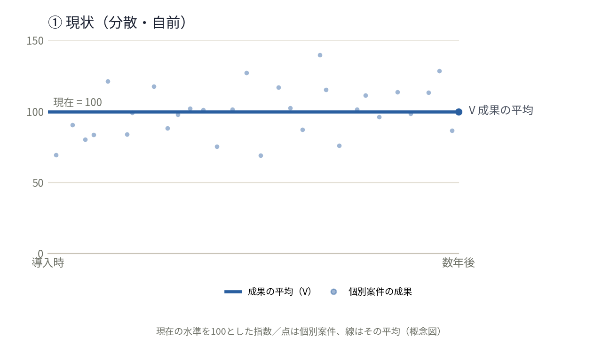
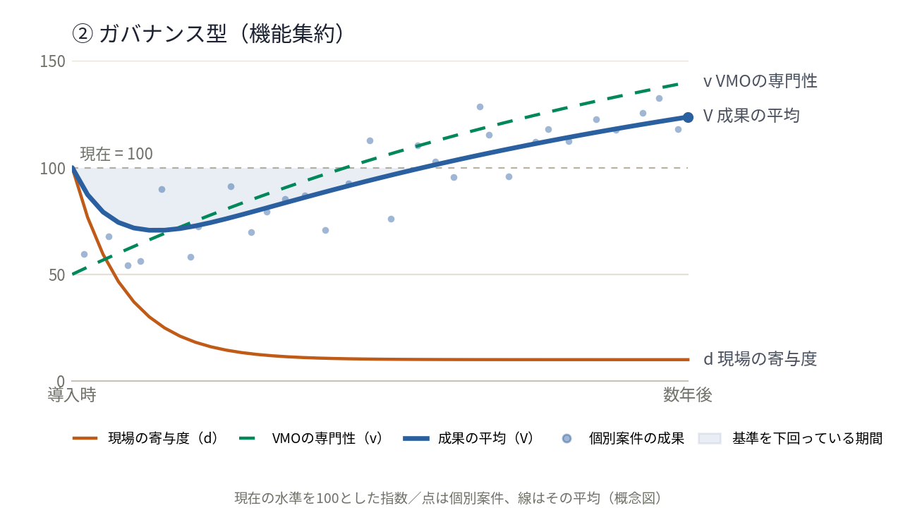
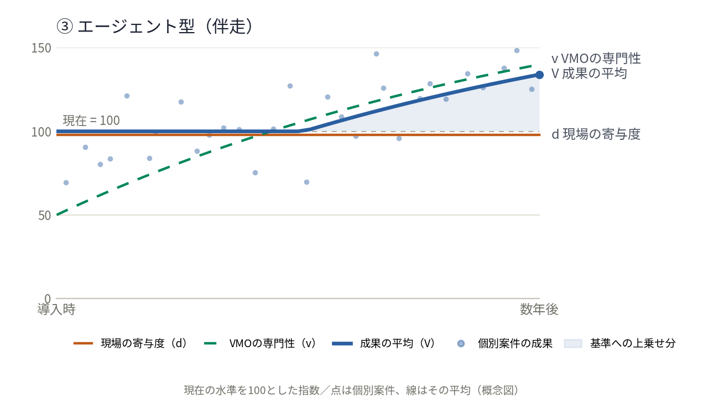

# 第2章：VMOの導入

> 本章は、VMOを置き、育てる立場にあるCIO・IT管理職に向けたものである。VMOをどの形で提供するか（2.1〜2.6）、どの水準を目指すか（2.7）、どのように人材を育て（2.8）、どう立ち上げて（2.9）、導入後に何を確かめるか（2.10）を示す。VMOの4つの役割は第3章 3.1で扱う。
>
> 本章のモデルでは、依頼部門（第1章）を**現場**と呼ぶ。現場の判断と力量がモデルの変数そのものだからである。

## 2.1 私たちが選ぶ形

VMOは、ベンダー対応の機能を現場から引き取って一元管理する「ガバナンス型」ではなく、**現場の意思決定とオーナーシップを維持したまま、交渉力と専門性を上乗せする「エージェント型（伴走型サービス）」**として価値を届ける。

現場からベンダー対応を引き取るのではなく、**現場の代理人として交渉と契約設計を担う**。判断とオーナーシップが現場に残るため、成果がいまの水準を下回ることがない。そしてVMOが経験を積むほど、その成長分が現場の成果に上乗せされていく。

以下では、なぜこの形を選ぶのかを、現状およびガバナンス型と並べ、式とグラフで確かめる。

<br>

## 2.2 3つのモデル

いまの姿を100とした指数で、3つを同じ物差しで比べる。VMOは立ち上げ時点では現場の半分（50）から始まり、案件が集まるほど育つ、と置く。**以下の数値はいずれも性質を示すための概念上の値であり、実測値ではない。** 各モデルの推移を図2-1〜2-3に、その描き方（式・パラメータ・数値表）を2.12に示す。

**① 現状（分散・自前対応）**

```
V = d
　V：案件全体の成果の平均（いまの水準を100とする指数）
　d：現場の寄与度（平均100、案件ごとにばらつく）
```

現場が自分で対応している、いまの姿である。全体の成果は案件ごとの積み上げで、一件ごとの結果は担当者の力量と経験に左右される。平均すれば100だが、うまくまとまる案件とそうでない案件の差が大きい。劣った状態という意味ではなく、比較の出発点である。ベンダー対応の経験が個人に閉じるため、時間が経っても水準は上がらない。

- 成果の平均：100 → 100／ばらつき σ：20 → 20



*図2-1　① 現状：平均は100のまま横ばい、案件ごとのばらつきは大きいまま*

**② ガバナンス型（機能集約）**

```
移管後：V(t) = v(t) ×（1 − λ）
移管中：V(t) = d(t) ＋ p(t) × v(t) ×（1 − λ）
　v(t)：VMOの専門性（同じ物差しの指数。案件が集まるほど育つ）
　λ　 ：現場の文脈がVMOへ渡りきらないことによる伝達ロス
　d(t)：現場の寄与度（移管が進むと0に近づく。移管後の式には残らない）
　p(t)：移管の進み具合（0＝移管前、1＝移管完了）
```

ベンダー対応の機能をVMOへ移す形である。移管が終われば現場はほとんど関与しなくなるため、**成果はVMOの水準そのものになる**。移管の途中は現場の寄与がまだ混ざるため、成果は100から下りていき、移管が進むにつれてVMOの水準へ収束していく。誰が担当しても同じ手順に乗るためばらつきは小さくなるが、VMOが現場の水準（100）に追いつくまで、平均は基準を割ったままになる。ガバナンス型が買っているのは、水準ではなく分散の縮小である。

- 成果の平均：100 → 124／ばらつき σ：20 → 7
- 現場の寄与度が急落する描き方は、意図的に理想化している（2.12）



*図2-2　② ガバナンス型：いったん基準を割り、VMOの水準に収束していく*

**③ エージェント型（伴走）**

```
V(t) = max ( d , v(t) − c )
　d　 ：現場の寄与度（伴走では平均100のまま保たれる）
　v(t)：VMOの専門性
　c　 ：伴走にかかる調整コスト（現場とVMOのやり取りの手間）
```

現場を残したまま、VMOを上乗せする形である。**現場の力量と、VMOが保証できる水準の、高い方を取る。** VMOが持ち込むのは相場、確認すべき観点、他契約からの交渉材料であり、それらは既に備えている担当者よりも、備えていない担当者にこそ大きく効く。したがって平均が上がると同時に、ばらつきも縮む。「100を下回らない」ことは仮定ではなく、この形から出てくる結果である。

担当者の力量がそのまま結果に効くため、VMOが育つまではばらつきは①と同じように残る。VMOが現場の水準と調整コストを超えた時点（v − c ＞ 100）から、分布全体が上へ持ち上がる。基準を超えたあとは②と同じようにばらつきを抑える効果も働くが、現場の寄与が残るぶん②ほど均一にはならない。**まず平均を押し上げ、そのあとにばらつきが収まる**モデルである。

- 成果の平均：100 → 134／ばらつき σ：20 → 11



*図2-3　③ エージェント型：基準を割らず、v − c が100を超えたところから持ち上がる*

<br>

## 2.3 3モデルの比較

| | ① 現状（自前対応） | ② ガバナンス型（分散を抑える） | ③ エージェント型（平均を上げる） |
|---|---|---|---|
| 式 | `V = d` | `V(t) = v(t) ×（1 − λ）` | `V(t) = max ( d , v(t) − c )` |
| 成果の平均（導入時→数年後） | 100 → 100 | 100 → 124 | 100 → 134 |
| ばらつき σ（同上） | 20 → 20 | 20 → 7 | 20 → 11 |
| 強み | 現場が全体を把握しており意思決定が速い。調整コストがかからない | 誰が担当しても同じ手順に乗るためばらつきが小さい。統制と監査対応が容易。VMO側に経験が集約されて育つ | 現場が100を保つため基準を割らない。VMOが育った分だけ分布全体が持ち上がり、基準を超えたあとはばらつきも収まる |
| 弱み | 案件ごとのばらつきが大きく結果が担当者に依存する。経験が個人に閉じて蓄積せず、水準が上がらない | 成果がVMOの水準そのものになり、**VMOが現場に追いつくまで基準を割り続ける**。伝達ロスが残り、現場の寄与度はほぼゼロになる | ばらつきが収まるのはVMOが基準を超えたあと。均一化の速さでは②に劣る。上乗せが生まれるまでは調整コストだけが乗る |

**②は分散を抑え、③は平均を上げる。** 同じ「VMOを育てる」でも、効く順番が違う。②は最初にばらつきを抑え、水準は後から追いつく。③はまず全体を持ち上げ、VMOが基準を超えたあとにばらつきが収まる。どちらを先に必要とするかで選び方が変わる。

<br>

## 2.4 分かれ目：育つ間のリスクを誰が負うか

②と③を分けるのは、**VMOが現場の水準（100）を超えるまでの期間を、誰が負担するか**である。

- ②では、成果がVMOの水準そのものになるため、VMOが現場に追いつくまで組織全体の成果が基準を割り続ける。**育つ間のリスクを現場（＝事業）が負う。**
- ③では、現場が下限を支えるため割り込まない。**育つ間のリスクをVMOだけが負う。**

導入初期から事業にリスクを負わせることなく、現場のスピードと意思決定権を維持したまま価値を積み上げていける。これが、私たちがエージェント型を選ぶ理由である。

<br>

## 2.5 早期相談は、モデル上の必然

VMOが育つのは、案件が集まるからである。式のなかで `v(t)` を成長させるものは、経験した案件数以外にない。

現場が早く声をかけるほど `v` が早く100を超え、上乗せの始まりが前倒しになる。**「早めにご相談ください」はお願いではなく、モデル上の必然である。** そして早い段階の相談ほど、選べる選択肢も交渉の余地も大きい。

<br>

## 2.6 3つから1つを選ぶ、という話ではない

3つのモデルは、どれかひとつが正解で残りは失敗する、というものではない。いずれも現実を単純化して性質だけを取り出した**基準線**である。基準線は位置を測るためのものであって、その上を歩くためのものではない。

実際には、案件の性質によって効く形が変わる。定型的で件数の多い契約と、金額も文脈も大きい契約とでは、適した距離の取り方が違う。VMOが育つにつれても動く。うまくいく形は、あらかじめ選ぶものではなく、進めながら形になっていく。図面どおりに組み上げるのではなく、実際に動く人の手の届き方に合わせて、少しずつ整えていくことになる。

必要なのは精緻なモデルではなく、**前提と目的の共有**である。いまVMOがどの水準にあり、何を引き受けられて、何がまだ引き受けられないのか。この案件で最も守りたいものは何か。それさえ共有されていれば、呼び名が①でも②でも③でも、その場に合った役割分担は見つかる。**前提と目的を共有したうえで、共同作業として進めること。それが唯一の正解だと考える。**

<br>

## 2.7 目指す水準

VMOを導入しても、ベンダー管理の水準は一足飛びには上がらない。次の5段階で現在地と目標を置く。

| 水準 | 名称 | 組織の状態 | ベンダー管理で見える姿 |
|---|---|---|---|
| 1 | 属人的 | 成果が個人に依存し、再現できない | 特定のベンダーに任せきりで、比較も評価もしない。契約の所在や更新期限を担当者しか知らない |
| 2 | 案件ごとに管理 | 案件ごとに計画・管理され、再現できる。ただし方法は案件・部門で異なる | 案件ごとに見積を比較し、契約書を結ぶ。評価の観点や記録の残し方は部門ごとに違う |
| 3 | 全社で共通 | 全社共通の手順・役割・データで、一貫して運用される | 選定・契約・検収・評価が共通の手順とデータで回る。契約形態の区別、取適法、GxPの要求が、依頼部門の手続きの中で漏れなく守られる |
| 4 | 指標で管理 | 成果と品質を指標で測定し、データに基づいて管理・予測する | 委託先の品質・SLA・コストを指標で比較し、相場・交渉実績に基づいて交渉・判断する |
| 5 | 継続的に改善 | 継続的な改善により、変化に先回りする | 重要なベンダーと指標を共有し、共同で改善を進める |

**立ち上げ後、まず水準3を目指す。** 委託取引には法令・規制上の要求があり（第1章 1.7）、それを依頼部門が確実に満たせる状態が水準3だからである。そのうえで、相場・交渉実績の蓄積を使って水準4へ進む。

水準3で共通にするのは**手順とデータ**であって、判断の所在ではない。誰が担当しても同じ観点で点検され、同じ形で記録が残るが、選定・契約・継続の判断は依頼部門に残る。ここを取り違えると、共通化の名のもとにガバナンス型へ滑っていく（2.4）。

<br>

## 2.8 人材：受付担当（L1）の成長段階

受付担当（L1）は、未経験者が担うことを前提にした役割である（役割は第3章 3.1）。L1の定型業務を一人で回せるようになったところから、段階的にL2（ベンダー担当・契約担当）の仕事へ広げていく。

| 段階 | 名称 | できるようになること |
|---|---|---|
| STEP 1 | L1定型業務の定着 | 相談受付・案件登録・声がけを、一人で回せる |
| STEP 2 | L1プラス | 判断が難しい相談を見立て、L2へ的確に引き継げる |
| STEP 3 | L2業務への着手 | ベンダー担当・契約担当の一部を任せられる |

次の段階に進めるかどうかは、二つの軸で判断する。

| 軸 | 測り方 | 判断 |
|---|---|---|
| 能力 | スキルで測る | ここまでできるようになったら、次の役割を任せる |
| 志向性 | 1on1で確認する | 本人のキャリアプランとして言語化されたら、次の仕事の本質を伝えてみる |

第3章 3.2.4の引き継ぎシーケンスは、STEP 1からSTEP 2へ進むための振り返りの材料として使う。

<br>

## 2.9 立ち上げの進め方

VMOは、相談を待つ前に始められることから立ち上げる。前半の2段階は相談がなくても進められ、早い時期に目に見える成果（更新期限の見逃し防止）を出せる。

| 段階 | 実施すること | この段階で得られるもの |
|---|---|---|
| 1 基盤づくり | 既存のIT契約を、契約書と支払実績の両面から棚卸しする。ベンダー情報・契約情報を整え、ベンダーのTierを判定する | 全社のITベンダー支出と、更新期限・解約通知期限の全体像 |
| 2 更新期限の声がけ | 解約通知期限から逆算して、依頼部門に声をかけ始める | 自動更新の見逃し防止。依頼部門との最初の接点 |
| 3 相談受付の開始 | 相談の入口を依頼部門に案内し、L1の受付を始める。早期相談の意味（2.5）をあわせて伝える | 案件が集まり始める |
| 4 対応と記録の蓄積 | L2が交渉・契約設計を行い、案件ごとに相場・交渉実績を記録する | VMOの専門性（v）が育つ材料 |
| 5 定期レビュー | 四半期・年次のレビューを回し、手順とデータを共通化する | 水準3への到達、水準4への足がかり |

依頼部門がすでに自分でベンダー対応をしている案件に、VMOが後から入る場合も、引き取るのではなく上乗せする。どの案件にどこまで関わるかは、相談のたびに依頼部門と合意する（第3章 3.2.3）。

<br>

## 2.10 導入後にモニタリングすること

エージェント型は、**現場の寄与が残っていることを前提に成り立つ**モデルである。前提が崩れれば（現場が判断を手放し、実質的に②へ移行すれば）、モデルの利点は失われる。したがって、その特徴を理解したうえで導入し、狙いどおりに機能しているかを継続的に確認する。平均がどれだけ上がり、ばらつきがどこまで収まったかを継続して可視化し、成果として示していく。

| 見るもの | 確認すること |
|---|---|
| 成果の平均 | 相談を経た案件の条件が、相談前・非相談案件と比べて改善しているか |
| ばらつき | 担当者による結果の差が縮まっているか |
| 現場の寄与 | 意思決定が現場に残っているか。VMOが決めてしまっていないか |
| 相談の時期 | 相談が早い段階で来ているか。契約直前の駆け込みが増えていないか |
| VMOの専門性 | 蓄積した相場・交渉実績が、実際に案件で使われているか |
| 手順と記録 | 選定・契約・検収・評価が共通の手順で行われ、記録が契約とベンダーに紐づいて残っているか（水準3の確認） |

<br>

## 2.11 補足：3モデルの推移（グラフの仕様）

3つのモデルを、同じ形式の3枚のグラフで示す。以下の仕様と数値表があれば、同じグラフを描ける。

図2-1〜2-3は、この仕様を実装した `../src/three_models_chart.py` で生成している（`python3 src/three_models_chart.py` で `images/` に再出力、`--table` で下の数値表を出力）。式やパラメータを変えるときは、スクリプトとこの節を同時に更新する。

### 共通の描き方

| 要素 | 仕様 |
|---|---|
| 横軸 | 時間 t。導入時を0、数年後を1とする（目盛りの数値は出さず、左端に「導入時」、右端に「数年後」と表示）。曲線は t を0.025刻み（41点）で計算して折れ線で結ぶ |
| 縦軸 | 現在の水準を100とした指数。0〜150。目盛りは0・50・100・150 |
| 基準線 | 100の位置に破線。ラベル「現在 = 100」 |
| 成果の平均 V | 青の太い実線（#2a5fa0）。右端に点と「V 成果の平均」のラベル |
| 現場の寄与度 d | 橙の実線（#c05a17）。右端に「d 現場の寄与度」のラベル（②・③のみ）。③では V と100で重なるため、描画上は約2下（97.9）にずらして両方の線が見えるようにする |
| VMOの専門性 v | 緑の破線（#00875a）。右端に「v VMOの専門性」のラベル（②・③のみ） |
| 個別案件の成果 | 青の半透明の点。1枚につき30件。t を30等分した区間ごとに1件ずつ位置をずらして置き、縦位置は V(t) に平均0・標準偏差 σ(t) の正規乱数を足したもの |
| 網掛け | Vと基準線（100）の間を薄い青で塗る。②は V＜100 の範囲（「基準を下回っている期間」）、③は V＞100 の範囲（「基準への上乗せ分」） |
| キャプション | 「現在の水準を100とした指数／点は個別案件、線はその平均（概念図）」 |

### 曲線の式とパラメータ

| 記号 | 式 | 意味 |
|---|---|---|
| v(t) | 201.1 − 151.1 × e^(−0.905t) | VMOの専門性。50から始まり、t＝0.5で約105、t＝1で140に達する飽和曲線。②・③で共通 |
| d(t)（②） | 10 ＋ 90 × e^(−12t) | ガバナンス型の現場の寄与度。移管開始とともに急落し、10（ほぼゼロ）に張り付く |
| p(t)（②） | 1 − e^(−11.25t) | ガバナンス型の移管の進み具合 |
| λ（②） | 0.19（正確には0.1875） | 伝達ロス |
| V(t)（②） | d(t) ＋ p(t) × v(t) × (1 − λ) | ガバナンス型の成果の平均 |
| d（③） | 100（一定） | エージェント型の現場の寄与度 |
| c（③） | 6 | 調整コスト |
| V(t)（③） | max(100, v(t) − 6) | エージェント型の成果の平均 |
| V（①） | 100（一定） | 現状の成果の平均 |

### 数値表（0.1刻み）

| t | v（②③共通） | d（②） | V（②） | V（③） |
|---|---|---|---|---|
| 0.0 | 50 | 100 | 100 | 100 |
| 0.1 | 63 | 37 | 72 | 100 |
| 0.2 | 75 | 18 | 73 | 100 |
| 0.3 | 86 | 12 | 80 | 100 |
| 0.4 | 96 | 11 | 88 | 100 |
| 0.5 | 105 | 10 | 95 | 100 |
| 0.6 | 113 | 10 | 102 | 107 |
| 0.7 | 121 | 10 | 108 | 115 |
| 0.8 | 128 | 10 | 114 | 122 |
| 0.9 | 134 | 10 | 119 | 128 |
| 1.0 | 140 | 10 | 124 | 134 |

①は全期間で V＝d＝100。

### グラフごとの描画要素と読み取り

| | ① 現状 | ② ガバナンス型 | ③ エージェント型 |
|---|---|---|---|
| 描く線 | V のみ（100で横ばい） | d・v・V | d・v・V |
| 網掛け | なし | t＝0〜約0.57（V＜100） | t＝約0.52〜1（V＞100） |
| 個別案件のばらつき σ(t) | 20で一定 | 移管が進むにつれ20から7へ縮む | VMOが基準を超える（t≒0.52）まで20、その後11へ縮む |
| 読み取り | 平均は動かず、点は100の上下に大きく散る | V は t≒0.2で最低（約71）まで落ち、t≒0.57で100に戻ってVMOの水準へ収束する。点は後半ほど線に寄る | V は100を割らず、v − c が100を超えたところから持ち上がる。点は前半は①並みに散り、後半に寄っていく |

<br>

## 2.12 補足：②の描き方の単純化について

②のグラフでは、移管の開始とともに現場の寄与度がほぼゼロへ向かう。これはガバナンス型を純粋な形で取り出したときの姿であり、モデルとしてはこの通りである。ただし現実にこの落ち方をしたなら、それは権限を取り上げられた現場や、役割を外された関係者が手を引いた状態——移管ではなく、組織としての破綻を意味する。

実際の移管はそうならないように設計する。契約の更新時期に合わせて段階的に移す、移管後も現場に残す役割を先に決めておく、外れる側の面目が立つように順序と伝え方を配慮する。それによって、この落差はもっと緩やかになる。ここでは②というモデルの性質を際立たせるために、あえて手当てのない形で描いている。
