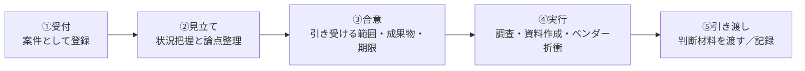
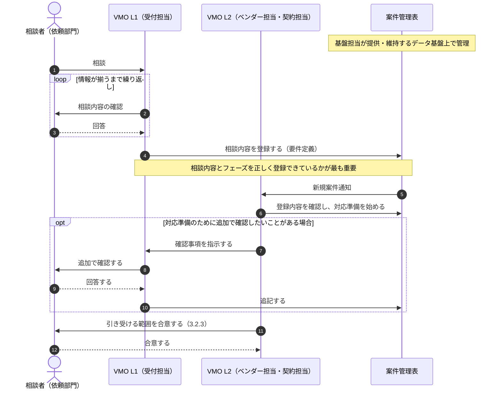

# 第3章：VMOの役割

> 本章は、VMOの担当者と、VMOと協働する人に向けたものである。VMOの4つの役割（3.1）、どの相談にも共通する動き方（3.2）、相談に応じるための基盤業務（3.3）、相談の入口ごとの対応（3.4）を示す。
>
> 具体的な手順、判断基準、様式は、今後整備する規定とRunbookで定める。本章は、それらを読む前に全体の流れをつかむための地図として使う。

## 3.1 VMOの4つの役割

VMOの担当者は、依頼部門から見えるL1（相談受付）・L2（対応）というサービス単位とは別に、内部的には次の4つの役割で業務を分担する。L1（受付担当）と基盤担当は平時のオペレーショナル業務（定型業務）を担い、L2（ベンダー担当・契約担当）はAdhocな個別対応に特化する「エージェント」として、案件が発生したときにだけ動く。

| 内部の役割 | L1/L2上の位置づけ | 業務の性格 | 主な仕事 |
|---|---|---|---|
| 基盤担当 | なし | 定型業務（改善含む） | ベンダー情報・契約情報のデータ整備と、案件管理表・相場情報・交渉記録などを管理するデータ基盤の提供・維持。あわせて、L1/L2プロセス全体のプロセスオーナー |
| 受付担当 | L1（相談受付） | 定型業務（改善含む） | 相談者とのやり取りを重ね、相談内容とフェーズを案件管理表に正しく登録する。契約更新期限に基づく声がけなど、定型的な働きかけも行う |
| ベンダー担当 | L2（Adhoc対応） | 個別事案への非定型対応 | 市場調査・相場感の提示、ベンダーとの価格・条件交渉 |
| 契約担当 | L2（Adhoc対応） | 個別事案への非定型対応 | 契約条件・SLAの設計、契約リスクと法令上の論点の洗い出し |

- 受付担当と基盤担当はいずれも平時のオペレーショナル業務であるため、実務上は同じ人材が互いにバックアップ要員を兼ねることが多い。ベンダー担当・契約担当はAdhoc対応に特化するため、この兼務の対象には含めない。
- L2は、ベンダー担当と契約担当が案件の性質に応じて連携し、ひとつの対応として相談者に返す。
- VMO管理者は、4つの役割を統括し、年次の計画（ベンダー戦略、予算起点の働きかけ。第4章）を所管する。
- 基盤担当は個別の相談のやり取りには直接関わらない。ただし、受付担当の登録もL2の参照も、基盤担当が整えるデータ基盤があって初めて成り立つ。基盤担当は、L1/L2プロセスが実際に機能しているかを見渡し、必要な見直しを行うプロセスオーナーでもある。

 

---

## 3.2 相談を受けるときの共通の型

### 3.2.1 相談から完了までの5ステップ

どの入口から相談を受けても、VMOの動き方は同じ5段階になる。

| ステップ | 担い手 | 落としてはいけない点 |
|---|---|---|
| ①受付 | 受付担当（L1） | 立ち話で終わらせず、案件として採番・登録する |
| ②見立て | L1 → L2 | 結論を急がず、打てる手と打てない手を切り分ける |
| ③合意 | L2 | 何を引き受け、何を引き受けないかを相談者と明示的に合意する |
| ④実行 | L2 | 相談者を飛ばしてベンダーと合意しない |
| ⑤引き渡し | L2 | 決めるのは依頼部門。結果と条件を記録に残す |

 

### 3.2.2 初回に確認する7項目

1. 対象のシステム／サービスと、利用している部門
2. いまどの段階か（未着手／候補あり／内示済み／契約済み）——**最も重要**
3. 決めなければならない期限と、その根拠
4. 現行契約の有無（金額・満了日・更新方式・解約通知期限）
5. 予算の状況（確保済み／これから／上限額）
6. **すでにベンダーに伝えてしまっていること**（予算額、内示の有無）
7. 最終的に誰が決裁するか

相談者に記入を依頼する項目は、付録A（相談受付テンプレート集）にまとめている。

 

### 3.2.3 引き受ける範囲の合意

| VMOが引き受けること | 依頼部門に残ること |
|---|---|
| 市場調査、相場情報の提供 | 業務要件の決定 |
| 評価基準の設計、比較表の作成 | 技術的な適合性の判断 |
| 契約条件・SLAの設計 | どのベンダーを選ぶかの決定 |
| ベンダーとの価格・条件交渉 | 予算の確保と社内承認 |
| 契約リスク・法令上の論点の洗い出し | 発注・検収・委託先の監督など、法令上の義務の履行（第1章 1.7） |

**伝え方の例**：「材料と交渉はこちらで引き受けます。決めるのは皆さんです。」

 

### 3.2.4 L1受付からL2対応への引き継ぎ（研修・振り返り用）

L1の役割は、相談者とのやり取りを重ねて、相談内容とフェーズを案件管理表に正しく登録することにある。一度の質問応答で済ませず、必要な情報が揃うまでやり取りを重ねる。

 

### 3.2.5 案件記録として残すもの

- 対象システム、ベンダー名、契約金額と契約期間
- 当初の提示条件と交渉後の着地条件、**その差分**
- 交渉で有効だった論点、通らなかった論点
- 見積の内訳（単価、数量、前提条件）
- 相談から完了までの実所要期間

 

---

## 3.3 相談に応じるための基盤業務

個別の相談に速く正確に応じられるかどうかは、平時にどれだけ情報を整えているかで決まる。基盤は基盤担当だけでは完成しない。受付担当（L1）が持つ現場の理解と、基盤担当が持つ社内データの理解を突き合わせて、初めて正しい状態を保てる。

| 業務 | 担い手 | 要点 |
|---|---|---|
| ベンダー情報・契約情報の維持 | 基盤担当（Tierの判定は受付担当） | 満了日・**解約通知期限**・更新方式・契約形態・取引の区分を必ず持つ。入力するだけでなく、正しい状態に保ち続ける |
| 相場・交渉実績の蓄積 | 基盤担当が基盤を提供、L2が記録 | 単価と数量の前提、当初条件と着地条件の差分、交渉論点の成否 |
| 契約更新期限の声がけ | 受付担当 | **満了日ではなく解約通知期限から逆算**する。12ヶ月前に方針確認、6ヶ月前にL2へ引き継ぐ |
| 検収記録・評価記録の紐づけ | 受付担当・基盤担当 | 依頼部門が作成した検収記録と、委託先の評価・監査の結果を、契約とベンダーに紐づけて残す |
| 案件記録とナレッジの蓄積 | 基盤担当が基盤を提供、L1・L2が記入 | 記録は個人ではなくVMOの資産として保管する |

ベンダーのTier（定義と、Tierごとのベンダーとの接点）は第1章 1.4.2による。Tierの判定は、年次の棚卸しの中で行う（下の業務サイクル）。

**平時の業務サイクル**

| 頻度 | 担い手 | 実施すること |
|---|---|---|
| 随時 | 受付担当 | 新規相談の受付と割り当て、進行中案件の期限確認 |
| 月次 | 受付担当 | SLA実績の確認、契約更新期限とプロジェクト終了時期の確認（Tier2の評価の準備） |
| 四半期 | 受付担当・基盤担当 | Tier4のベンダーの扱いの決定（調達部門・IT担当者と協議） |
| 年次 | 受付担当・基盤担当 | 全契約の棚卸しとTierの判定、ベンダー戦略の策定（予算がある程度決まった時点）、Tier1との来期に向けた会議、Tier3の統合の協議、翌年度の予算支援 |

レビューの結果、交渉や契約見直しが必要になった場合は、その都度L2に引き継ぐ。

**Tierごとの会議体**

第1章 1.4.2のTierごとの接点を、次の会議体で運営する。頻度は調達部門と合意したものである。

| 会議 | 対象 | 参加者 | 頻度 | 議題 |
|---|---|---|---|---|
| 来期会議 | Tier1 | ベンダー、IT担当者（システムオーナー・担当BP）、調達部門、VMO | 年次（予算がある程度決まった時点） | 中長期の提案を受ける。削減目標と求める条件を示す |
| 事前の方針合わせ | Tier1 | IT担当者、調達部門、VMO | 来期会議の前 | 交渉案（目標、譲れる条件と譲れない条件）を合わせる |
| 評価とヒアリング | Tier2 | IT担当者、関係者、VMO | 契約更新時、またはプロジェクト終了時 | パフォーマンス評価と関係者ヒアリング。結果をベンダーにフィードバックし、次回の取引・更新に活かす |
| 統合の協議 | Tier3 | 調達部門、IT担当者、VMO | 年次 | Tier1・Tier2、または他のTier3への統合 |
| 巻き取りの協議 | Tier4 | 調達部門、IT担当者、VMO | 年次の棚卸しと、契約が見つかった時点で随時協議し、四半期ごとに決定する | 他のTierのベンダーへの巻き取り、自動更新の停止・解約 |
| 四半期報告 | 全Tier | 部門予算統括責任者、VMO | 四半期 | 4つの指標と実行シグナル別の金額の推移（第4章 4.4 ステップ6） |

 

---

## 3.4 相談の入口ごとの対応

相談の入口は、第1章 1.3.2の4フェーズ・11種である（選定・契約には、契約締結後の引き渡しと検収の支援を加える）。入口ごとに、相談者が「自分の案件もこれに当たるかもしれない」と気づけるよう典型的なケースを挙げ、それぞれにVMOがどう対応するかを示す。

### 3.4.1 探索

#### 選択肢と相場感を知りたい

| こんなケース | VMOのアプローチ |
|---|---|
| 事業部門から「AIで何かできないか」と言われたが、何から調べればよいか分からない | 業務課題に戻して、解決したいことと必須の要件を整理してから、製品・サービスの類型を示す |
| 展示会やベンダー訪問で紹介された製品が気になるが、ほかにも選択肢があるのか知りたい | 同じ課題を解くほかの類型・製品を並べ、紹介された製品の位置づけを示す |
| 自社開発・パッケージ・SaaSのどれにすべきか、判断の材料がない | 類型ごとに、費用の構造（初期／継続）、導入期間、自由度、ベンダーへの依存の度合いを比べる |
| 稟議や中期計画に載せるため、おおよその金額だけ先に知りたい | 費用を単一の数字ではなく、**レンジと前提条件**で示す。前提が変わると金額がどう動くかも添える |
| 他部門や他社が使っているサービスと同じものを入れたい | 社内の既存契約を確認し、ライセンスの追加や契約の相乗りで済むかを先に調べる |
| ベンダーに話を聞きたいが、聞いた時点で営業が始まるのが心配 | 情報収集であることをベンダーに明示し、窓口をVMOに置いて接触を管理する |
| いまの仕組みが古く、置き換えの候補があるのか知りたい | 現行の利用実態と契約の終期を確認し、置き換えの候補と移行に要する期間の目安を示す |

 

### 3.4.2 選定・契約

#### RFP・見積依頼の準備

| こんなケース | VMOのアプローチ |
|---|---|
| 複数社から見積を取りたいが、RFPを書いたことがない | 雛形をもとに、目的・範囲・要件・評価の方法を一緒に書き起こす |
| 見積を取ったが「一式」ばかりで比べられない | 内訳と前提条件の様式を指定して取り直す |
| 各社の提案がばらばらで、どれが良いか決められない | 評価基準と配点を決めて、同じ物差しで比較表にする。次からは**提案を受け取る前に確定**する |
| 推したいベンダーがあるが、公平に選んだと説明できるようにしたい | 評価基準を先に固め、選定の経緯を記録に残す |
| 声をかけるベンダーがいつも同じ会社になる | ベンダー台帳と市場の情報から、新しい候補を加える |
| 期限が迫っていて、正式なRFPをやる時間がない | 案件の規模とリスクに応じて手順を軽くし、外せない点だけを押さえる |
| ベンダーからの質問に、どこまで情報を出してよいか迷う | 秘密保持契約の範囲を確認し、質問と回答を全社に同じ内容で共有する |

#### 決まっている案件の契約前確認

| こんなケース | VMOのアプローチ |
|---|---|
| ベンダーも金額もほぼ決まっていて、来週には発注したい | 選定はやり直さない。価格と契約条項の点検に絞り、期限内に終わる範囲で交渉の論点に優先順位をつける |
| 提示された価格が妥当なのか分からない | 単価と数量に分け、他案件・他社水準・過去の契約と比べる |
| ベンダーの標準契約書（約款）をそのまま使ってよいのか不安 | 自動更新、解約、責任の上限、データの返還、再委託の条項を点検し、変更を求める点を絞る |
| 海外ベンダーの英文契約を読み込めていない | 主要な条項を日本語で要約し、自社に不利な点を示す |
| 長期契約や一括前払いなら値引きすると言われた | 値引きの額と、途中で解約しにくくなるリスクを並べて判断材料にする |
| 業務委託のはずが、実態は常駐して指示を出す形になりそう | 契約形態（請負・準委任・派遣）と働き方のずれを指摘し、偽装請負にならない形を依頼部門と確認する |
| 既存ベンダーへの追加発注で済ませたい | 随意契約とする理由を記録に残し、既存契約の単価・条件を引き継げるか確認する |

#### 契約条件の詰め方

| こんなケース | VMOのアプローチ |
|---|---|
| SLAを決めてほしいと言われたが、何を何%にすればよいか分からない | 止まったときの事業への影響から逆算して、項目と水準を決める |
| 「稼働率99.9%」とあるが、何をどう測るのか分からない | **計測の方式と、時計を止める条件**（計画停止など）を定義する |
| SLAを守れなかったときにどうなるのか、契約に書かれていない | 未達時の措置（報告、改善計画、サービスクレジット、解約権）を設計する |
| 将来ベンダーを替えるとき、データや資料を返してもらえるか心配 | 出口条項（データ返還の形式と期限、移行の支援、削除の証明）を入れる |
| 何をもって完成・受け入れとするかが曖昧 | 検収の条件と期間、不合格のときの扱いを定義する |
| 個人情報や機密情報を預けることになる | 保管場所、暗号化、再委託、事故時の通知を契約に入れる（付録E） |
| GxPの対象システムで、品質面の取り決めが必要 | 品質取決めの要否を依頼部門・品質保証部門と確認し、契約と整合させる |
| 夜間・休日も対応してほしいが、どこまで求めるべきか迷う | 提供時間と、SLAの時計の数え方を決める（付録C・D） |

#### 契約締結後の引き渡し

| こんなケース | VMOのアプローチ |
|---|---|
| 契約を結んだが、この後何をすればよいか分からない | 窓口、エスカレーションの経路、初回レビューの日を決めて依頼部門に引き渡す |
| 契約書や条件がどこにあるか、後から分からなくなりそう | 契約の情報を台帳に登録し、契約書と紐づけて保管する |
| 解約通知の期限や更新日をうっかり過ぎてしまいそう | 期限と更新日をカレンダーに登録し、期限の前に知らせる |
| アカウント発行や入館手続きなど、立ち上げの準備が漏れそう | 契約締結後30日の作業をオンボーディングのチェックリストで確認する（付録B） |
| 運用が始まってからの定例会をどう組めばよいか分からない | 月次レビューのアジェンダを用意し、報告の項目をSLAと合わせる（付録B） |

#### 成果物の検収（支援）

検収を行うのは依頼部門である。VMOは契約上の条件を示し、記録を残す。

| こんなケース | VMOのアプローチ |
|---|---|
| 納品物が届いたが、何を確かめて検収すればよいか分からない | 契約上の検収条件を示し、確認する項目に落とす |
| 不具合が残っているが、検収してよいのか迷う | 不合格のときの扱いと、条件付きで受け入れる場合の記録の残し方を示す |
| 検収が遅れていて、支払期日に間に合うか心配 | 検収と支払期日の関係を示し、遅れたときの影響を伝える |
| 月額・準委任の契約で、毎月何を確かめればよいか分からない | 作業報告書と稼働の実績を、契約と突き合わせる方法を示す |
| 監査に備えて、検収の証跡を残しておきたい | 検収の記録を契約に紐づけて残す |

 

### 3.4.3 運用・改善

#### 対応品質に納得がいかない

| こんなケース | VMOのアプローチ |
|---|---|
| 問い合わせへの回答が遅く、何度も催促している | 事象を日時つきで記録し、SLAの実績と突き合わせる |
| 障害が繰り返されるのに、再発防止策が出てこない | 原因分析と再発防止策の提出を求め、月次レビューで追う |
| 担当者がよく替わり、そのたびに説明し直している | 体制・主要要員に関する条項を確認し、体制の維持を改善要求に含める |
| 報告書の中身が薄く、何をしているのか見えない | 報告の項目を契約・SLAと照らして定義し直す |
| 不満はあるが、契約上ベンダーに何を言えるのか分からない | 「定義のある未達」と「定義のない不満」に分ける。前者は契約に基づいて求め、後者は次の更新で定義する |
| 口頭で何度も伝えているのに改善されない | 改善要求を**書面で**行い、改善計画と期限を出させる |
| 他部門も同じベンダーに不満を持っていそう | 同じベンダーとの他契約の状況を集め、まとめて申し入れる |

#### 値上げを要請された

| こんなケース | VMOのアプローチ |
|---|---|
| 来期から値上げすると通知が来た | 根拠（人件費、為替、原価など）を分解し、価格改定の条項と通知の期限を確認する |
| SaaSのライセンス体系が変わり、実質的に値上がりする | 新しい体系で自社の利用実態に合わせて試算し、旧体系の継続や別のプランを交渉する |
| 毎年のように値上げされている | 過去の改定の履歴と他社の水準を並べ、上げ幅の妥当性を示す |
| 受け入れるしかないと思っている | 同じベンダーとの他契約、契約期間、数量を交渉の材料にする |
| 回答の期限が短く、検討の時間がない | 契約上の通知期限を確認し、期限の延長を申し入れる |
| 値上げの代わりにサービスの内容を減らすと言われた | 減る内容を金額に置き換え、実質の値上げ幅として比べる |
| この機会に他社への乗り換えも考えたい | 「続けるか迷っている」の進め方に切り替える |

#### 来年度の予算の積み方

| こんなケース | VMOのアプローチ |
|---|---|
| 予算申請の期限が近いが、来年の金額をどう見積もればよいか分からない | 現行契約の実績と増減の要因を集め、前提条件つきの予算案にする |
| 新しい案件を予算に入れたいが、ベンダーがまだ決まっていない | 類型ごとの費用レンジから積み、選定の時期とアプローチを決めておく（第4章） |
| 契約の更新時期と会計年度がずれていて、計上がややこしい | 契約期間と会計年度の重なりを整理し、年度ごとの金額に割り付ける |
| 為替や値上げの影響をどこまで見込めばよいか分からない | 価格改定の条項と過去の改定履歴から幅を示す |
| ベンダーに概算見積を頼みたいが、発注を約束したと思われたくない | 概算見積が発注の約束ではないことを明示して依頼する |
| 予算を削るよう言われたが、どこを削ればよいか分からない | 契約ごとに利用実態と削れる余地を整理し、候補を挙げる（第4章） |
| 他部門から移ってきた契約の中身が分からない | 契約書と支払の実績を集めて台帳に登録し、来期の金額を確かめる |

#### 契約が入り組んで見えない

| こんなケース | VMOのアプローチ |
|---|---|
| 同じベンダーと契約がいくつもあり、全体でいくら払っているか分からない | ベンダー単位で契約と支払を集計する |
| 請求書は届くが、どの契約に対する支払なのか分からない | 契約書と支払の実績を突き合わせ、**契約のない支払**を見つける |
| 使っていないのに支払だけ続いているものがありそう | **支払のない契約**や使われていない契約を見つけ、解約・縮小の候補にする |
| 基本契約・個別契約・注文書・覚書が重なり、どれが有効か分からない | 契約関係図を作り、有効な条項と優先順位を整理する |
| 前任者から引き継いだが、契約の経緯が分からない | 契約書・稟議・やり取りの記録から経緯をたどり、台帳に残す |
| 部門ごとに同じSaaSを別々に契約している | 契約を一覧にし、まとめた場合の条件を試算する |
| 再委託先が何社あり、誰がデータを扱っているのか把握できていない | 再委託の状況を確認し、契約上の承認・報告が必要かを整理する |

 

### 3.4.4 見直し・転換

#### 体制が実態に合っていない

| こんなケース | VMOのアプローチ |
|---|---|
| 開発が終わったのに、開発時と同じ人数の体制が続いている | 利用の実績から差を数字で示し、期中に変えられる条件を確認して交渉する |
| ライセンス数が実際の利用者より多い | 利用状況を確認し、減らせる時期と条件を調べる。**縮小も増強と同じ優先度で扱う** |
| 利用者が増えて、いまの体制では回らない | 増やす量を実績から見積もり、単価と条件を交渉する |
| 24時間対応の契約だが、夜間の問い合わせはほとんどない | 提供時間を見直す（付録C） |
| 要員のスキルが作業の内容に合っていない | スキルの要件と単価の関係を確認し、体制の入れ替えを求める |
| 拠点や対象業務が変わり、契約の範囲とずれている | SOWの範囲と実態の差を整理し、変更契約を作る |
| 期中は変えられない契約だと言われた | 変更の条項と次の更新時期を確認し、更新時の条件変更を準備する |

#### 続けるか迷っている

| こんなケース | VMOのアプローチ |
|---|---|
| 契約の更新が近いが、このまま続けてよいのか分からない | **解約通知の期限を最初に確認**し、判断の期限を決める |
| 他社の方が安い・良いと聞いた | 他社と並べる前に、継続するときの条件をまず交渉で引き出す |
| ベンダーの経営状況やサポートの継続が心配 | ベンダーの状況と、製品・サービスの提供終了の予定を確認する |
| 製品のサポート終了（EOL）が近い | サポート終了日から逆算し、継続と移行の選択肢を並べる |
| 乗り換えたいが、移行の手間とコストが読めない | 二重稼働の期間を含む切替コストを試算し、継続案と比べる |
| ベンダーに頼りきりで、替えられる気がしない | 依存の要因（データ、ノウハウ、契約）を整理し、依存を下げる手立てを示す（第4章） |
| 買収・統合で、ベンダーの会社が変わった | 契約の承継と、条件の変わる点を確認する |

#### 縮小・廃止を控えている

| こんなケース | VMOのアプローチ |
|---|---|
| システムを来年廃止するが、関係する契約を把握できていない | ライセンス、保守、クラウド、回線など、関係する契約を棚卸しする |
| いつまでに解約を伝えればよいか分からない | **最も早い解約通知の期限**から逆算して、解約のスケジュールを作る |
| 預けているデータを返してもらい、確実に消してほしい | データ返還の形式・期限と、削除証明の取得を段取りに入れる |
| 前払いや年間契約の残り期間はどうなるのか | 前払分の精算と違約金の有無を契約で確認する |
| 新システムへの移行中は、旧システムも動かし続ける必要がある | 二重稼働の期間と費用を見込み、旧契約の終期を合わせる |
| 事業の撤退や組織の再編で、契約をまとめて整理したい | 契約を一覧にし、終了・承継・継続に振り分ける |
| 廃止後も記録を一定期間残さなければならない | 保存期間（GxPなど）は依頼部門が確認する。保存の方法は契約が終わる前に決める |

