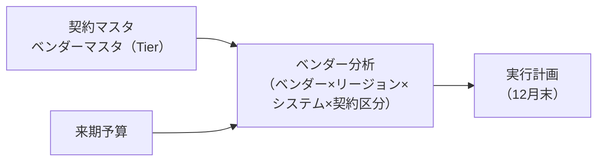
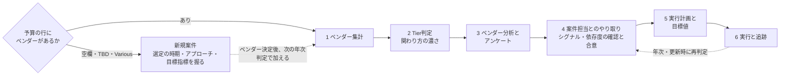

# 第4章：予算起点の働きかけ

> 本章は、VMO担当者と、VMOと協働する案件担当・調達部門に向けたものである。来年度の予算を起点に、VMOが相談を待たずに働きかけ、1〜3か年でコスト削減またはそれに代わる価値をベンダーから引き出し、契約に落とし込む活動の考え方と進め方を示す。
>
> 本章では、予算の行を所管するGDSの案件の担当者（システムオーナー・担当BP）と予算責任者を、まとめて**案件担当**と呼ぶ。
>
> Tierの定義とTierごとのベンダーとの接点は、第1章 1.4.2による。年度ごとの段取り、作業用のファイル、説明会資料は `../budget-driven-activity/` に置く。

## 4.1 目的と骨格

> 来年度予算を起点に、VMOが相談を待たずに各案件担当へ働きかけ、調達部門と連携して、**1〜3か年でコスト削減またはそれに代わる価値をベンダーから引き出し、契約に落とし込む**。

今年1年をかけて契約マスタ・ベンダーマスタを整え、取引額と重要度でベンダーをTierに分けた。来期は、ここに予算計画を重ねる。

- **関わり方の濃さ**はTierで決まる。Tierはベンダーへの評価ではない。GDSが、どのベンダーにどのくらい力を割くかの濃さであり、施策をどの接点（場と時期）で扱うかを決める。
- **打ち手の型**は契約区分で決まる（4.5〜4.8）。契約区分は、コストが何で決まり、いつ動くかが同じ契約のまとまりである。打ち手の型は、Tierには左右されない。
- **実行できるか**は依存度で決まる（依存度 → 実行シグナル。4.2）。
- 依存度が「中」の取引は、**依存を下げる活動**を施策と並行して進め、案件担当と合意したうえで施策を実行する。依存を下げること自体が、2年目・3年目の削減の前提になる。

この活動はVMOから働きかけるが、どの施策をいつやるかを決めるのは案件担当である。VMOには決裁権も、通らなければならない関門としての強制力もない（第1章 1.5）。

 

## 4.2 依存度と実行シグナル（実行できるか）

依存度が高いほど、VMOが打てる手は限られる。そのため依存度は、Tierを決める軸ではなく（第1章 1.4.2）、**施策を実行できるかどうかの条件**として扱う。

- 依存度は**ベンダー単位ではなく、ベンダーをリージョン×システム×契約区分に分解した単位**で判定する。同じベンダーでも、システムやリージョンによって依存の度合いが違うためである（たとえば、同じベンダーのCRMは「高」、BIツールは「中」ということがある）。
- 依存度は、アンケートの回答（実施できない理由）を手がかりに、案件担当とのやり取りで判定する（4.4 ステップ3・4）。

**依存度の定義**

| 依存度 | 定義 |
|---|---|
| 高 | 現場レベルでは対処できず、IT戦略の転換を要する依存 |
| 中 | 今すぐではないが、現場レベルで依存を下げる余地がある |
| 低 | 依存していない |

**実行シグナルの定義**

| 実行シグナル | 依存度 | 意味 |
|---|---|---|
| Green | 低 | 施策を実行する |
| Yellow | 中 | 案件担当との合意次第で、施策を実行できる。あわせて、依存を下げる活動を進める |
| Red | 高 | 契約区分ごとの施策は実行しない。依存の解消はIT戦略・アーキテクチャの所管へ上げる。VMOは分析を提供し、契約条件の打ち手（価格上限、ライセンスのセグメント化、AI契約の分離など）に限って関わる |

**依存の型**

依存度が中・高の取引は、依存を生んでいるものを型として記録する。型によって、依存を下げる手段と、その成果として契約に残すものが違う。

| 依存の型 | 依存を生んでいるもの | 依存を下げる手段 | 契約に残すもの |
|---|---|---|---|
| 取引上の依存 | 個別の契約の結び方（契約・データ・切替費用、機器の供給と保守の一体化など） | 出口条件を整え、代替候補を確保する。供給と保守を分ける | 出口条項、データ返還・移行支援、メーカー保守の分離 |
| ブラックボックス | 業務範囲・工数・ノウハウ・構成情報がベンダー側にしかなく、中身が見えない（キーマン依存を含む） | 業務範囲・工数・スキル要件・構成情報を可視化する。運用保守委託では、工数調査と契約形態の移行（業務スコープ・SLA・スキル要件の文書化）がこれにあたる | 文書の自社帰属、工数報告の義務、構成情報の提出義務 |
| 知見の希少性 | その領域を担える担い手が市場に少ない | 依存を前提に、条件で安定させる | 長期の価格上限、体制維持・後継者育成の義務 |
| ロックイン戦略 | ベンダー自身が依存を事業モデルとして設計している（業務への依存を待ってからの価格転嫁、コミット額の下方硬直、入口の製品から隣接領域へ広げる戦略など）。SaaSベンダーの多くがこの戦略をとる | 移行の準備を進める（代替製品の評価、データの可搬性の確保、契約の分離）。手間と時間はかかるが、現場の能力と時間で抜けられることが多い | 価格上限、ライセンスのセグメント化、AI契約の分離、データの返還・移行支援 |

- **依存の型と依存度は別に判定する**。依存の型は「何が依存を生んでいるか」、依存度は「現場レベルで抜けられるか」を表す。ロックイン戦略の型でも、別の製品への切替が現場の能力と時間で可能なら依存度は「中」になる（たとえば、データベースを別のデータベースに切り替える）。依存度が「高」になるのは、抜けるのに全社のIT戦略や標準の転換を要する場合に限る（たとえば、全社標準になっている基盤製品）。
- 「取引上の依存」と「ロックイン戦略」は、依存を生んでいる主体が違う。取引上の依存は個別の契約から生じるため、更新時に出口条件を整えれば下げられる。ロックイン戦略は、ベンダーが製品・契約体系をまたいで意図的に作っているため、契約交渉だけでは下がらず、移行の準備（技術的な代替）を伴う。
- 依存度が「低」の取引は、依存の型を記録しない。

 

## 4.3 目標設定

この活動の目標は、次の4つの指標で設定する。

| 指標 | 何を目標にするか | 目標の種類 | 何で測るか |
|---|---|---|---|
| 削減 | 支払額そのものを下げる（単価、数量、エディション、契約の統合など） | 定量（金額） | 当年度は確定予算との差、翌年度以降は現行契約のランレートとの差。予算台帳の予実と、締結した契約の金額で確かめる |
| 値上げの回避 | ベンダーが提示した値上げ・アップリフトを抑える | 定量（金額） | ベンダーの提示額と合意額の差。提示の書面と交渉記録で確かめる。削減とは別の枠で示す |
| 代わりの価値 | 価格以外の条件を引き出す（価格上限条項、減席の権利、解約・縮小の権利、SLAの強化とクレジット、追加の席・サービス・研修など） | 定性（件数）。金額に換算できるものは定量に加える | 締結した契約に入った条件の件数と内容 |
| 依存の低減 | 依存を下げた成果を契約に残す（出口条項、文書の自社帰属、構成情報の提出、メーカー保守の分離など） | 定量（金額・件数） | 再判定で実行シグナルがYellowからGreenに移った取引の金額と、契約に残した条件の件数 |

- **目標値は、案件担当と合意した施策から積み上げる。** 上から割り振るものではない。
- 案件ごとに、目指す指標を決めてから取り組む。取り組んだことと結果を担当者ごとに記録し、成果が出なかった案件も理由を残して、「やらなかった」と「できなかった」を区別する。
- 見直して変えるところがなかった契約は「確認済み」として記録する。それも成果の一つとして扱う。
- 予算編成ですでに予算に織り込んだ削減は、成果として二重に数えない。
- 4つの指標は、四半期ごとの報告（4.4 ステップ6）で同じ形で示す。

 

---

## 4.4 進め方

作業は母集団ファイル（Excel）の上で行う。

| シート | 単位 | 使う手順 | 内容 |
|---|---|---|---|
| 新規案件 | 予算の行 | 最初の分岐 | ベンダーが空欄・TBD・`Various`の予算の行（列はベンダー分析と同じ）と、選定の時期・アプローチ・目指す目標指標 |
| ベンダー集計 | ベンダー | 1・2 | 予算の合算、取引額の大小、重要度・終期の入力と根拠、Tier |
| ベンダー分析 | ベンダー×リージョン×システム×契約区分 | 3・4 | VMO施策（契約区分ごとのシグナルと打ち手）、アンケートの回答、依存度・依存の型、実行シグナル、案件担当との合意、実行判断、依存を下げる手段、契約マスタとの突き合わせ |
| 施策マスタ | 契約区分×シナリオ | 3 | 契約区分ごとのシナリオ、シグナルと打ち手（4.8）、契約に落とす条項の例 |

### 最初の分岐：ベンダーが決まっていない予算（新規案件）

予算の行のベンダーが空欄・TBD・`Various`（複数・不特定）になっている場合は、新規案件と同じ扱いとし、Tier判定とベンダー分析の対象から外して別に扱う。ベンダーが特定できないため、Tierも依存度も判定できないためである。

- これらの予算は、取引額の累計8割の計算（分母）に含めない。
- **事前に握ること**：案件担当・調達部門・VMOで、次の3点を認識合わせしておく。

| 握ること | 内容 |
|---|---|
| 選定の時期 | ベンダー選定をいつ行うか（予算の執行時期と契約の開始時期から逆算する） |
| 選定のアプローチ | RFI、RFP、随意契約のどれで進めるか |
| 目指す目標指標 | 4.3の4つの指標（削減、値上げの回避、代わりの価値、依存の低減）のうち、どれを目指すか（複数選択）。新規の契約は、依存を作らない条件（出口条項、データ返還・移行支援、文書・構成情報の自社帰属、価格上限など）を最初から入れられる機会でもある |

- VMOの関わりは、相談の入口のうち「探索」「選定・契約」にあたる（第3章 3.4.1・3.4.2）。
- 認識合わせの結果は、母集団ファイルの「新規案件」シートに記録する。
- ベンダーが決まったら、次の年次判定でベンダー集計に加え、Tierと依存度を判定する。

### ステップ1：ベンダー集計をつくる

- 来年度の予算台帳から、ベンダー取引でない行（人件費・減価償却・出張研修、社内費用）と、新規案件として扱う行（ベンダーが空欄・TBD・`Various`）を除き、年額を予算レートで円に換算する。
- ベンダー単位で合算する（リージョン・契約・事業部門から移管された予算を含む）。
- この時点では施策の扱いは決めない。施策の中身は契約区分で、扱う接点はTierで決まり、実行できるかは分解した単位の依存度で決まるためである。

### ステップ2：Tierを判定する（ベンダー単位）

Tierは第1章 1.4.2の定義を使う。この活動では、取引額に来期の予算額を使い、予算額の上位から累計8割までのベンダーを「大」とする。取引実績で分ける定常業務のTierと一致させる必要はない。Tierの案はVMOが作り、確定はGDSが行う。

| | 重要度：高 | 重要度：低 |
|---|---|---|
| 取引額：大（上位からの累計8割まで） | Tier1 | Tier3（契約の終期が確定しているベンダーを含む） |
| 取引額：小 | Tier2 | Tier4 |

### ステップ3：ベンダー分析をつくり、アンケートをとる

**分解と施策**

- ベンダー集計のリージョン・システム・契約区分を分解し、1行＝ベンダー×リージョン×システム×契約区分とする。
- 契約区分は6つ（ライセンス・SaaS、運用保守委託、開発・改修、ミドルウェア、オンプレ維持、クラウド。4.5）。予算台帳の費用区分からの初期値で、行ごとに修正できる。
- 行ごとに、契約区分から、区分ごとのシグナルと打ち手（4.8）を施策マスタから引く。施策の中身は契約区分で決まり、Tierには左右されない。Tierは、施策をどの接点で扱うかを決める（次の表）。

| Tier | 接点 | ねらう価値 |
|---|---|---|
| Tier1 | 年次の来期会議で、中長期の提案を受ける | 1〜3か年の価値を引き出す主な場。削減目標と求める条件を示し、提案を契約条件に落とす |
| Tier2 | 契約更新時・プロジェクト終了時の評価とヒアリング | 評価結果をもとにした更新時の条件交渉 |
| Tier3 | 接点は設けず、年次で統合を協議する（Tier1・Tier2、または他のTier3へ） | 統合による削減 |
| Tier4 | 他のベンダーへの巻き取りを随時協議し、四半期ごとに決める | 契約数の削減、自動更新の停止・解約 |

**アンケート**

- 対象：ベンダー分析の行を所管する案件担当。担当している行だけ、1行ごとに答えてもらう。
- 聞くのは次の3つだけとする。シグナルが出ているか、依存度がどうかは聞かない。それらはステップ4のやり取りで一緒に確かめる。

| 質問 | 選択肢 |
|---|---|
| 1 実施可否 | 可／条件付きで可／不可／判断できない |
| 2 時期 | 活動の対象期間の四半期から1つ（FY2027は2027 Q1〜2028 Q4） |
| 3 実施できない理由 | 契約上いまは動けない／作業内容や構成を自社で把握できていない／代わりの会社が見当たらない／製品・契約体系から抜けにくい／全社の標準・IT戦略に関わる／業務上の都合（プロジェクト中など）／実施済み・予算に織り込み済み／その他 |

- 「判断できない」も回答として扱う。分からないことが分かるのも、大事な情報である。
- すでに手を打っている契約は「実施済み・予算に織り込み済み」と答えてもらい、成果として二重に数えない（4.3）。
- 回答は、Tierと契約区分ごとに整理する。

**実施できない理由から見る依存の型（読み替えの目安）**

| 実施できない理由 | 疑う依存の型・扱い |
|---|---|
| 契約上いまは動けない | 取引上の依存。契約の時期の問題であれば、次の更新を時期に置く |
| 作業内容や構成を自社で把握できていない | ブラックボックス |
| 代わりの会社が見当たらない | 知見の希少性 |
| 製品・契約体系から抜けにくい | ロックイン戦略 |
| 全社の標準・IT戦略に関わる | 型にかかわらず、依存度「高」（Red）の候補 |
| 業務上の都合（プロジェクト中など） | 依存ではない。時期を改める |
| 実施済み・予算に織り込み済み | 今回の対象から外す |
| その他 | ステップ4のやり取りで確かめる |

読み替えは目安であり、依存度と依存の型の判定はステップ4で行う。

### ステップ4：案件担当とのやり取りで確かめ、合意する

アンケートの回答をもとに、案件担当と個別にやり取りする。VMOのL2（ベンダー担当・契約担当）が臨み、L1が日程を調整する。

**シグナルを確かめる**

- 行ごとに、契約区分ごとのシグナル（4.8）が出ているかを一緒に確かめ、シグナル表の判定欄（R／A／G）を付ける。
- 打ち手は、出ているシグナルから選ぶ。あわせて、当社が交渉に臨める時期にあるか（4.6）を確かめる。
- シグナルが見つからなければ、その契約はいまの形で適正である。「確認済み」として記録する（4.3）。

**依存度と依存の型を判定する**

- 記録：依存度・依存の型・やり取りの相手と日付、判定の根拠をメモに残す。
- 判定の目安：次の問いに答えてもらい、4.2の定義に当てはめる。問いと目安は、案件担当との会議で合意しておく。

| 問い | 「いいえ」のときに疑う依存の型 |
|---|---|
| 業務範囲・作業内容・工数を、自社で説明できるか | ブラックボックス |
| 構成情報・設計書・手順書・パスワードを、自社で持っていて最新か | ブラックボックス |
| 特定の担当者がいなくなっても、運用を続けられるか | ブラックボックス（キーマン依存） |
| 契約に出口条項（解約・データ返還・移行支援）があるか | 取引上の依存 |
| 製品の供給と保守・作業の委託を、別の会社に分けて頼めるか | 取引上の依存 |
| 同じ業務を担える会社が、市場にほかにあるか | 知見の希少性 |
| ベンダーが、利用の拡大や値上げを前提にした製品・契約体系をとっているか | ロックイン戦略 |
| 抜けるのに、全社のIT戦略や標準（アーキテクチャ、全社標準の製品）を変える必要があるか | （型にかかわらず）「はい」なら依存度「高」 |

- 判定の例：ネットワーク機器（サーバ・L4スイッチなど）を納入した業者がそのまま保守している場合、構成情報が業者の手元にしかなければブラックボックス、メーカー保守をその業者経由でしか買っていなければ取引上の依存で、いずれも現場レベルで下げられるため「中」（Yellow）とする。構成情報を自社で持ち、メーカー保守と作業委託が分かれていれば「低」（Green）とする。
- 必要に応じて、行ごとに契約情報（第1章 1.4）と突き合わせ、契約ID・契約形態・更新日・解約通知期限・自動更新・アップリフト・減席の可否を写す。予算の行と契約を結ぶキーは、ベンダー・システム・リージョンを基本とする。契約の出口条項の有無は、依存度の判定の根拠にもなる。

**施策と時期を合意する**

行ごとに、どの施策をいつやるかを案件担当と合意し、ベンダー分析シートの「現場との合意」（合意済／協議中／不同意）に記録する。Yellowの行は、次の4点を合意する。

| 合意すること | 内容 |
|---|---|
| 施策の範囲 | 契約区分ごとの施策のうち、どこまでを実行するか。切替を前提にした手を使うか |
| 依存を下げる手段 | 型に応じた手段（4.2）のうち、何を、どの更新で契約に入れるか |
| 時期 | 施策と依存を下げる活動を、どの更新・どの会議で行うか |
| 役割 | 案件担当・VMO・調達部門・ベンダーのそれぞれが何をするか（構成情報の回収、工数の報告など） |

- 合意できた行は「実行する」になり、ステップ5の計画に載せる。
- 不同意の行は施策を実行せず、理由をメモに残し、翌年の再判定で扱う。

**依存を下げる活動**

- 依存を下げる活動は、施策と並行して進める独立した取り組みとして扱う。依存を下げる手段は、型ごとに4.2の表のとおり。
- 成果は**契約に残す**（出口条項、文書の自社帰属、構成情報の提出義務、メーカー保守の分離など）。成果は4.3の「依存の低減」として数える。
- 依存が下がった行は、再判定でYellowからGreenに変わる。それまで見送っていた施策（統合・巻き取り・切替を前提にした交渉など）を、次の更新で実行できるようになる。

**Redの行：上位へ上げる**

- 依存の解消はIT戦略・アーキテクチャの所管へ上げる。VMOは、各契約がベンダーにとって先行投資（値引きで利用を広げる）と回収（値上げ・コミット増額）のどの局面にあるかの分析を提供する（4.6）。
- VMOは契約条件の打ち手に限って関わる（Tier1であれば来期会議で、価格上限やライセンスのセグメント化を求める）。

**再判定**

- 依存度と実行シグナルは、年次のベンダー戦略の策定時と、各契約の更新時に再判定する。依存を下げる活動の成果や、IT戦略の転換によって、シグナルが変わるためである。

### ステップ5：実行計画と目標値をまとめる

- 合意した行（Green、および案件担当と合意済みのYellow）を、実行計画にまとめる。活動の対象期間は年度ごとに決める（FY2027はFY2027〜FY2028の2年間）。
- 案件ごとに、**GDSで単独で行うこと**と**調達部門と協働すること**に分ける。
- 目標値は、合意した施策から積み上げる（4.3）。
- 更新日と通知期限から着手時期を逆算する（既定は通知期限の12か月前に方針確認、6か月前に交渉開始。第3章 3.3）。Tier1は年次の来期会議に、Tier2は更新時・プロジェクト終了時の評価に、Tier3・Tier4は年次・四半期の協議に載せる。
- 協議中のYellowの行は、合意を取る時期を置く。依存を下げる活動は、成果を契約に入れる更新を置く。Redの行は、IT戦略の所管へ上げる時期と、契約条件の打ち手を置く。
- 効果が出る年度で並べる。
  - 1年目：Greenの行と合意済みのYellowの行で、すでに着手できる更新、または期中の契約変更
  - 2年目：1年目のTier1会議と評価で準備し、更新で取るもの。依存を下げる活動の成果を契約に入れるもの
  - 3年目以降：依存が下がってGreenになった行での統合・巻き取り・切替。運用保守委託のベンダー集約。対象期間を超えるものは、次の年度の計画で扱う
- 成果物：**実行計画（活動カレンダー）**と**目標値・価値の見込み**（確度：確定／見込み／検討中、発現時期、下限〜上限）。

### ステップ6：実行と追跡

**働きかけの型**

1. Tier1との来期会議の前に、案件担当・調達部門と方針を合わせる。Tier3・Tier4は、統合・巻き取りの協議の場で扱う。
2. VMOが分析と交渉案（目標、打ち手、譲れる条件と譲れない条件、依存を下げるために契約に入れる条件）を示す。
3. 案件担当が方針を決める。
4. 交渉には、案件担当が調達部門と連携して臨む。調達部門には必ず事前に共有し、事後報告にはしない。発注と契約の締結・変更・解約は、調達部門が購買規程にもとづいて行う。VMOは条件の案と記録で支える。
5. 上位の意思決定を要するもの（全社のIT戦略の転換を要する依存への対応方針など）は、IT戦略・アーキテクチャの所管へ上げる。

**調達部門との情報連携**

活動の節目ごとに、調達部門と情報を共有する。

| 節目 | 共有するもの |
|---|---|
| M1 | 説明会の内容（取り組み候補とアンケート）の事前共有 |
| M2 | アンケートの回答の取りまとめ |
| M3 | 案件担当との合意結果と、調達部門と協働する案件 |
| M4 | 実行計画（GDSで単独で行うことと、調達部門と協働すること） |

**追跡と報告**

- 施策一覧（施策、対象額、想定削減率、削減額の下限〜上限、確度、発現時期、主担当）を価値の登録簿として維持し、ベンダー名で予算台帳とつなぐ。合意できた削減は、予算台帳の見込みと差異の理由に反映する。
- 四半期ごとに部門予算統括責任者へ報告する。報告は、4.3の4つの指標を分けて示し、**実行シグナル別の金額の推移**（YellowとRedがどれだけGreenに移ったか）をあわせて示す。
- Redの行は、IT戦略・アーキテクチャの所管へ定期的にまとめて報告する。
- 運用保守委託の契約形態の移行は、コスト削減ではなく、文書化の進み具合とSLAの達成状況で報告する。

 

---

## 4.5 契約区分と、打ち手の型

契約区分は、コストが何で決まり、いつ動くかが同じ契約のまとまりであり、区分ごとに打ち手の型が決まる。区分の境界の判断は `../budget-driven-activity/contract-categories_definition.md` による。区分ごとに典型的なシナリオを2つ置き、シナリオごとのシグナルと打ち手を4.8に示す。

| 契約区分 | 定義 | 具体的な対象 | コスト構造 | 典型的なシナリオ（4.8） |
|---|---|---|---|---|
| ライセンス・SaaS | パッケージ／SaaSのライセンス・サブスクリプション費 | ERP、CRM、HCM、ITSM、Microsoft 365 など、ユーザー単位・従業員単位の継続課金 | 席数×単価。値上げは更新のタイミングに集中する | 全社で使うもの／特定の業務で使うもの |
| 運用保守委託 | 既存システムの運用保守委託費 | SIerへの年間保守契約 | 人月単価×要員数 | 運用コスト（作業量）／移行コスト（社内解決率） |
| 開発・改修 | 開発・改修プロジェクト費。単年度の投資的支出 | システムの開発・改修案件、法改正や製品の保守終了への対応 | 案件ごとの見積もり。人月単価が効く | 新規システム開発／既存システムの追加改修 |
| ミドルウェア（DB・運用管理・連携） | データベース・運用管理・データ連携のライセンス・保守費 | Oracle Database、Java、JP1、DataSpiderなど | ライセンス＋年間保守料。ライセンス体系が複雑 | サーバーに紐づくミドルウェア／連携のミドルウェア |
| オンプレ維持 | オンプレ資産の維持費 | ハードウェア保守、データセンター、回線 | 機器の保守料・ラック費用・回線費用 | 買い替え／延命 |
| クラウド | IaaS／PaaSの利用料。コミット契約と従量課金 | AWS、Azure、GCP などの基盤サービス | 利用量×単価。コミット額（上乗せ幅・繰越）で決まる | 全社のコミット契約／部門・プロジェクトのアカウント（それぞれ安定・増減） |

どのTierにも、6つの契約区分の契約が入っている。

 

## 4.6 ベンダーから見た、交渉に臨む時期

6つの契約区分は、ベンダーから見ればそのまま6つの収益モデルである。相手の収益の式と、相手が回収を終える時期から、交渉の臨み方を考える。

| 契約区分 | 収益モデル | 相手の利益の式 | 回収 | 伸ばし方 | 相手が重視する指標 |
|---|---|---|---|---|---|
| ライセンス・SaaS | サブスクリプション | 席数×単価×粗利率×継続月数 − 獲得コスト（値引き・営業） | 長期：数年かけて回収 | 利用者の増加、上位プラン | LTV、解約率、NRR |
| 運用保守委託 | 人月×単価の継続収入 | （請求単価 − 要員の原価）×人数×月数 − 引き継ぎ費用 | 中長期：体制が続く限り毎月 | 継続、要員・範囲の追加 | 稼働率、契約の継続率 |
| 開発・改修 | 案件ごとの受注 | （工数×標準単価 ＋ 多重請負に伴う間接費）− 仕入原価 − 出精値引き | 短期：案件ごとに完結 | 仕様変更、次の案件 | 受注額、人月単価 |
| ミドルウェア | ライセンス＋毎年の保守料 | ライセンス数×（ライセンス代 ＋ 保守料（毎年）×年数） | 長期：一度売れば保守料が続く | 保守の継続、導入数の増加 | 保守の更新率 |
| オンプレ維持 | 機器の販売＋保守契約 | 台数×（機器の粗利 ＋ 保守料×年数）。期限後の保守料は高い | 周期：数年ごとの買い替え | 保守の延長、機器の買い替え | 更新（買い替え）の周期 |
| クラウド | 従量課金＋コミット | 消費量×（単価 − 原価）− 移行支援・クレジット | 長期：使うほど増え続ける | 消費の増加、隣の領域 | コミット額、消費の伸び |

- 式のうち、変数は交渉できる部分、定数は交渉できない部分である。
- 相手が持ち出し（損益分岐の前）のうちは、相手も離れられないため、当社に力がある。損益分岐を越えると、相手には失うものが少なくなり、当社は乗り換えにくくなっていく。
- 開発・改修の見積は、仕入原価の側で積まれた工数である。出精値引きは、利益が社内の基準を超えないよう超えた分を値引きで返すもので、交渉で勝ち取った譲歩ではない。動かせるのは、工数、標準単価、商流の階層である。有利な時期は、案件ごとの見積の段階である。
- ミドルウェアは、保守料も購入価格で決まるため、有利なのは買う前だけである。オンプレ維持は、買う前に加えて、保守期限のときにもう一度有利な時期が来る（第三者保守という代わりの手があるため）。

**やること**は、当社が有利な時期にある相手から優先して取り組むことである。相手が有利な時期の契約も、時間をかけて材料を揃えて交渉に臨む。**やらないこと**は、その逆である。相手が有利な時期でも、代わりの手を用意できれば力は取り戻せる（4.7）。

> この見方は、典型的な形から立てた仮説である。実際の時期は、契約とベンダーごとの状況を確かめて見極める（4.4 ステップ4）。

 

## 4.7 契約の形を動かす4つの打ち手

交渉に臨むときに動かせるのは、契約の形と条件である。**形は隣へ一歩ずつ動かし、条件は形を変えずに整える。**

契約の形は、支払い方（横）と契約の単位（縦）の2軸で4つに分かれる。

| | 定額（契約時に金額が決まる） | 変動（実績や利用量で金額が決まる） |
|---|---|---|
| **個別に結ぶ**（システム・作業・水準ごとに分ける） | 個別×定額：システムごとの年間保守（人月・体制で固定）、案件ごとの一式請負、機器ごとの保守 | 個別×変動：作業項目ごとの実績払い（T&M）、利用した分だけの従量課金 |
| **まとめて結ぶ**（複数のシステム・拠点・部門を1本に） | 包括×定額：複数年契約、包括ライセンス、一括コミット | 包括×変動：SLAで結ぶマネージドサービス、単価表を合意した包括契約 |

| 打ち手 | 向き | 効果 |
|---|---|---|
| 実績ベースにする | →（定額から変動へ） | 実績に応じて払う |
| 確定させる | ←（変動から定額へ） | 単価や総額が読める |
| まとめる | ↓（個別から包括へ） | 数量と期間で条件を引き出す |
| 分ける | ↑（包括から個別へ） | 中身ごとに水準を選べる |
| 整える | 形は動かさない | 更新や延長の機会に、価格上限や通知期間などの条件を足し、条件を良くする。どの形からでも使える |

- **斜めには動かさない。** 単位と支払い方を同時に変えると、何が効いたのか分からなくなる。
- どの打ち手を使うかは、契約区分ごとのシグナル（4.8）から決める。交渉に臨める時期にあること（4.6）が前提である。シグナルが見つからなければ、その契約はいまの形で適正である。

 

## 4.8 契約区分ごとのシグナルと打ち手

区分ごとに、典型的なシナリオを2つ置き、シナリオごとにシグナルと打ち手を示す。シグナルは、打ち手が効く兆候であり、指標（コストに先立って動くもの）の側に出る。打ち手の向き（→←↓↑）は4.7のとおりで、向きのないものは「整える」である。

- 打ち手の型は契約区分で決まり、Tierには左右されない。Tierが決めるのは、施策を扱う接点（場と時期）である（4.4 ステップ3）。
- シグナル表の判定（R／A／G）は、案件担当とのやり取り（4.4 ステップ4）で一緒に付ける。
- シナリオは典型的な形から立てた模式であり、裏付けは `../budget-driven-activity/proposal/vmo-briefing_cost-curve_evidence.md` による。

### 4.8.1 ライセンス・SaaS

**ねらう価値**：削減／値上げの回避／代わりの価値

| シナリオ（指標） | 流れ |
|---|---|
| 全社で使うもの：Microsoft 365など（利用者数） | 評価：適合を確認 → パイロット：少数で試す → 長期契約1回目：3年・単価固定・最低数量 → 2回目：最適化した数量で更新 → 3回目：次の値上げの影。長期契約を結ぶと、コストは利用者数に連動せず、契約のたびに階段状に上がる。パイロットから利用者数が天井を打つまでは、コストが利用を下回る |
| 特定の業務で使うもの（利用者数） | 個人で使う：便利なツールとして → チームで使う：チームで契約する → 部門をまたいで使う：監査の対象になる。業務に組み込まれるほど、管理とベンダーサポートの固定費が重くなる。コストが利用を下回ることはない |

**全社で使うもの**

| No | シグナル | 打ち手 |
|---|---|---|
| 1 | 利用者数が天井を打った | 整える：利用状況を確かめ、使われていないライセンスを回収する |
| 2 | 更新の前に、値上げが発表された | ↑ 分ける：使い方に応じてF3・E3・E5を混ぜ、必要な数と種類を確定する |
| 3 | 法人契約のメリットを受けられなくなる | 整える：数量割引に代わる条件（価格上限・減席の権利）を交渉する |
| 4 | 期中に、製品の体系が一新される | ↑ 分ける：利用状況を調べ直し、次の契約の最低条件と他製品への移行を探る |

**特定の業務で使うもの**

| No | シグナル | 打ち手 |
|---|---|---|
| 1 | 業務に組み込まれる | ↓ まとめる：個人・チームの契約を1本にまとめ、管理下に置く |
| 2 | 管理が煩雑で、IT部門・ヘルプデスクの支援が不十分 | 整える：保守契約の範囲とサポートの水準を確かめてから結ぶ |
| 3 | 監査対応など、付随する業務が重い | ↑ 分ける：有償サービスとオンサイトは、監査対象の業務に絞って頼む |

**まとめ**：使い方を変えても、契約の形と条件が変わらなければ、コストは下がらない。コストが動くのは契約の節目だけである。そこまでに、利用のシグナルを打ち手に変えておく。

### 4.8.2 運用保守委託

**ねらう価値**：依存の低減（初年度は文書化）／将来の集約

| シナリオ（指標） | 流れ |
|---|---|
| 運用コスト（作業量） | 稼働した直後：障害・問い合わせが多く、体制で結ぶのが合理的 → 安定してくると：作業量は減るが、契約は体制のまま単年の自動更新で続く → 終盤：廃止・移行の作業が増える。安定期の見直しが、終盤の廃止・移行のコスト管理の準備になる |
| 移行コスト（社内解決率） | 稼働した直後：社内にも知識と判断役がいる → 安定してくると：関与が薄れ、知識は委託先に集まる → KPIを割ると：移行コストが跳ね上がる。社内解決率は、チケット全体のうち委託先にエスカレーションせず社内で解決できた比率で、この線を越えるのは安定して手がかからない時期である |

**運用コスト**

| No | シグナル | 打ち手 |
|---|---|---|
| 1 | 作業量が稼働直後から下がりきった | → 実績ベース：最初の更新で、作業区分ごとの実績で払う形に移す |
| 2 | ベンダーから複数年契約の提案が来た | 整える：受ける前に、作業量の実績と体制の差を確かめる |
| 3 | 月次報告が定型化し、稼働率が一定 | 整える：作業区分ごとの実績を求め、契約外の作業がないか確かめる |

**移行コスト**

| No | シグナル | 打ち手 |
|---|---|---|
| 1 | 手順書や構成情報が委託先にしかない | 整える：範囲・SLA・スキルを文書化し、文書を自社に帰属させる |
| 2 | 変更の影響や見積の妥当性を、社内で判断できない | 整える：社内に判断役（賢い発注者）を残す |

**まとめ**：運用保守の打ち手は、体制と作業がどこまで見えているかで決まる。保守メンバーと作業の実績をベンダーと同じ台帳で管理し、台帳は自社が持つ。契約の節目に反映する。

### 4.8.3 開発・改修

**ねらう価値**：削減（単価・集約）／代わりの価値

| シナリオ（指標） | 流れ |
|---|---|
| 新規システム開発：案件で払う（新しい要件） | 提案：RFP・提案書 → 要件定義：要件を予算に収める → 設計・開発、本番稼働：工程ごとに契約する → 二次：要件定義（ひとまわり小さく）→ 二次：設計・開発（リリースまで）。提案依頼書の内容で予算を確保し、要件定義の初めに膨らんだ要件を予算に収める。外れた要件のうちRFPの目的に強く関わるものが、二次開発の候補になる |
| 既存システムの追加改修：体制で払う（要件と重要課題） | 開発体制：開発メンバー → 運用体制への移行期：運用メンバーが加わる（早い時期に始まる）→ 運用体制：開発メンバーが抜け、定型の対応で回す。固定定額のまま、開発体制から運用体制へ切り替わり、切り替えは外から見えにくい。要件と重要課題の天井が、開発メンバーが抜ける時期の目安になる |

**新規システム開発**

| No | シグナル | 打ち手 |
|---|---|---|
| 1 | 要件定義の初期に、要件が膨れ上がる | 整える：RFPの目的に効く要件を見分け、予算内と二次開発の候補に振り分ける |
| 2 | 見積の解像度が低い（「一式」） | 整える：作業項目ごとの積み上げで見積もり、再見積の条件を決めておく |
| 3 | 開発の中盤以降に、二次開発の打診が来る | ↑ 分ける：一次のスコープに入る分を切り分け、一次で対応させる |
| 4 | 二次開発の前に、体制の固定を打診される | 整える：追加改修の契約形態は、要件の充足度と効果評価をもとに先に決めておく |

二次開発の多くは、本来は一次開発のスコープである。追加の予算を取る前に、一次開発でどこまで効果が出たかを示せる状態にしておく。体制の固定の打診は受け入れられないのが普通で、その後の追加改修を固定契約で結ぶための布石であることが多い。

**既存システムの追加改修**

| No | シグナル | 打ち手 |
|---|---|---|
| 1 | チケットの対応者が変わり、対応が定型化する | 整える：対応者と対応内容の変化を記録し、体制変更の計画を確かめる |
| 2 | 要件と重要課題が天井を打った | 整える：残る要件と重要課題を一覧にし、開発メンバーが抜ける前に引き継ぐ範囲を決める |
| 3 | エスカレーションが増え、応答時間が変わる | 整える：件数と応答時間の推移を見て、運用体制に移った後にサービスレベルと契約を見直す |

**まとめ**：開発・改修の打ち手は、要件と課題をどこまで管理できているかで決まる。要件・問題をベンダーと同じ台帳で管理し、台帳は自社が持つ。二次開発や体制の契約に反映する。

### 4.8.4 ミドルウェア

**ねらう価値**：削減／依存の低減

ミドルウェアは、OSとアプリケーションの間で、アプリケーションが共通に使う機能を提供するソフトウェアである。ライセンスの数が何に紐づくかで2つに分ける。

| シナリオ（指標） | 流れ |
|---|---|
| サーバーに紐づくミドルウェア（配備数・台数）：Oracle Database、Java、VMware、JP1など | 導入：ピークの数で買い、全環境を同じ条件に → 統合・移行：台数が減っても保守料は残る → 更新：課金体系の変更（Java・VMwareなど）が重なる |
| 連携のミドルウェア（連携の本数）：DataSpider、ASTERIA Warp、OPENWAY FTなど | 1つ目のSaaS：連携とブリッジを個別に作る → SaaSが増える：1対1の連携が、システム数の2乗に近い速さで積み上がる → GxPが絡む：連携ごとにDI（データインテグリティ）の検証が乗る |

**サーバーに紐づくミドルウェア**

| No | シグナル | 打ち手 |
|---|---|---|
| 1 | 統合・移行で、配備数が減る | ↑ 分ける：環境ごとに保守レベルとライセンスの種類を選ぶ |
| 2 | 配備数が減っても、保守料が変わらない | 整える：保有数を配備数に合わせ、部分解約の条件と保守料の根拠を確かめる |
| 3 | ベンダーが課金体系の変更を発表する | ↑ 分ける：一部を代替製品に移し、依存を下げる |

**連携のミドルウェア**

| No | シグナル | 打ち手 |
|---|---|---|
| 1 | SaaSの導入のたびに、連携を個別に作る | ↓ まとめる：DataSpider・OPENWAY FTなどを共通の連携基盤に寄せる |
| 2 | 連携の本数が、システム数より速く増える | 整える：連携の一覧を台帳にし、使われていない連携を止める |
| 3 | GxPに関わり、連携ごとにDI検証が乗る | ↑ 分ける：DIが必要な連携だけを高い水準で検証し、検証済みの基盤を使い回す（DIをなくすことはできない） |

**まとめ**：ミドルウェアの打ち手は、保有と配備、連携の実態をどこまで把握できているかで決まる。ライセンスの保有数と配備数、連携の一覧を自社の台帳で持ち、更新の前に突き合わせる。

### 4.8.5 オンプレ維持

**ねらう価値**：削減／依存の低減

サーバーは購入時に3年前後の保証が付き、その間の保守費は低い。一方、機器は業務アプリケーションのライフサイクルに合わせて短くても5年は使うため、保証が切れて有償の保守に移ることは避けられない。どちらのシナリオも、台数は変わらない前提である。

| シナリオ（指標） | 流れ |
|---|---|
| 買い替え（故障率）：コストは微増を続ける | 保証期間中：保守費は低い → 保証が切れると：有償保守に移る → 5年で買い替えても：ラック・電力・回線の費用は残る。人件費、電気代、場所代、データセンターの共通費の配賦が少しずつ上がる。故障率は3年を過ぎると上がり始めるが、買い替えで低い水準に戻る |
| 延命（故障率）：サポート終了後も上がり続ける | 5年までは：買い替えと同じ → 買い替えないと：一部の機能のために構成が残る → サポート終了後は：延長保守・ESUを重ねる。故障率は上がり続け、それに沿ってコストも上がる |

**買い替え**

| No | シグナル | 打ち手 |
|---|---|---|
| 1 | 保証期限が近づく | 整える：第三者保守や他のベンダーと比べてから、有償保守を結ぶ |
| 2 | 故障率が上がり始める（3年目以降） | 整える：機器の重要度に合わせて保守レベルを分ける |
| 3 | 買い替えの時期が決まる | 整える：台帳と突き合わせ、使っていない機器の保守を外す |
| 4 | 買い替えで、台数が減る | 整える：ラック・電力・回線の区画と契約の単位を見直す |

**延命**

| No | シグナル | 打ち手 |
|---|---|---|
| 1 | 主な業務システムの更改が決まる | ↑ 分ける：残す機能だけを切り出し、元の構成は止める |
| 2 | メーカーがサポート終了（EOL）を発表 | 整える：移行の時期を決め、延命は期限内に収める |
| 3 | 延命の間も、故障率が上がり続ける | 整える：延長保守・ESUの単価と期間を比べ、止める監視・環境を決める |

延命の段階でコスト削減を求められても、できることは、個別の24時間監視を死活監視だけにする、検証環境の電源を落とす、といったことに限られる。だからこそ、延命のNo 1の切り出しを早めに考える。

**まとめ**：オンプレ維持の打ち手は、機器と保守契約の対応をどこまで把握できているかで決まる。機器台帳と保守契約・保守期限を自社の台帳で突き合わせ、保証切れとサポート終了の前に判断する。

### 4.8.6 クラウド

**ねらう価値**：削減／値上げの回避／代わりの価値

クラウドのコスト管理は、単価の最適化（コミット・予約）と、使用量の最適化（適正化・停止）の組み合わせである。クラウドだけは、契約の単位とワークロードの性質の2×2で、4つのシナリオに分ける。

| | 安定して動くワークロード（本番。コミット・予約の対象） | 増減するワークロード（開発・検証・プロジェクト） |
|---|---|---|
| **全社のコミット契約** | ① コミットの本丸（安定した利用量） | ② 消化のための利用（コミットの消化） |
| **部門・プロジェクトのアカウント** | ③ 割引の外にある安定利用（アカウントごとの利用量） | ④ 放置されるリソース（リソース数・タグのない利用） |

| シナリオ | No | シグナル | 打ち手 |
|---|---|---|---|
| ① コミットの本丸 | 1 | 移行後に、利用量が安定する | ← 確定させる：安定した部分だけを予約・コミットに載せる |
| | 2 | 更新前に、コミット額の提案が来る | 整える：利用の実績から額を決め、繰越・減額の条件を入れる |
| ② 消化のための利用 | 1 | コミットの未達が見えてくる | → 実績ベース：変動分はコミットから外し、従量に戻す |
| | 2 | 消化のために、利用を増やす | 整える：消化目的の利用を止め、次のコミット額を実績で決める |
| ③ 割引の外にある安定利用 | 1 | 個別アカウントで常時動くものがある | ↓ まとめる：全社の契約に寄せ、割引の対象にする |
| | 2 | 同じ用途のアカウントが部門ごとにある | 整える：アカウントの一覧を台帳にし、持ち主を決める |
| ④ 放置されるリソース | 1 | タグのない利用が増える | 整える：タグを付け、費用の持ち主を決める |
| | 2 | 一時的に増やしたリソースが戻らない | 整える：使っていないものを止め、期限を付けて作る |

**まとめ**：FinOpsの原則（FinOps Foundation）のとおり、割引とコミットは中央で最適化し、利用は使う側が責任を持つ。①②のコミットはGDSが全社で決め、③④のアカウントとリソースは持ち主を決めて管理する。
