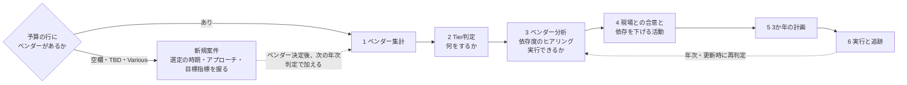

# 第4章：予算起点の働きかけ

> 本章は、VMO担当者と、VMOと協働するIT担当者・調達部門に向けたものである。来年度の予算を起点に、VMOが相談を待たずに働きかけ、1〜3か年でコスト削減またはそれに代わる価値をベンダーから引き出し、契約に落とし込む活動の考え方と進め方を示す。
>
> Tierの定義とTierごとのベンダーとの接点は、第1章 1.4.2による。年度ごとの計画と作業用の母集団ファイルは、`plans/` の年度別フォルダに置く。

## 4.1 目的と骨格

> 来年度予算を起点に、VMOが相談を待たずに各IT担当者へ働きかけ、調達部門と連携して、**1〜3か年でコスト削減またはそれに代わる価値をベンダーから引き出し、契約に落とし込む**。

- **何をするか**はTierと区分で決まる（Tier×区分 → VMO施策）。
- **実行できるか**は依存度で決まる（依存度 → 実行シグナル）。
- 依存度が「中」の取引は、**依存を下げる活動**を施策と並行して進め、現場と合意したうえで施策を実行する。依存を下げること自体が、2年目・3年目の削減の前提になる。

この活動はVMOから働きかけるが、意思決定は依頼部門に残る（エージェント型。第1章 1.5）。

 

## 4.2 依存度と実行シグナル（実行できるか）

依存度が高いほど、VMOが打てる手は限られる。そのため依存度は、Tierを決める軸ではなく（第1章 1.4.2）、**施策を実行できるかどうかの条件**として扱う。

- 依存度は**ベンダー単位ではなく、ベンダーをリージョン×システム×費用区分に分解した単位**で判定する。同じベンダーでも、システムやリージョンによって依存の度合いが違うためである（たとえば、同じベンダーのCRMは「高」、BIツールは「中」ということがある）。
- 依存度は**IT担当者へのヒアリング**で判定する（4.4 ステップ3）。

**依存度の定義**

| 依存度 | 定義 |
|---|---|
| 高 | 現場レベルでは対処できず、IT戦略の転換を要する依存 |
| 中 | 今すぐではないが、現場レベルで依存を下げる余地がある |
| 低 | 依存していない |

**実行シグナルの定義**

| 実行シグナル | 依存度 | 意味 |
|---|---|---|
| Green | 低 | 施策を実行する |
| Yellow | 中 | 現場（IT担当者）との合意次第で、施策を実行できる。あわせて、依存を下げる活動を進める |
| Red | 高 | Tier×区分の施策は実行しない。依存の解消はIT戦略・アーキテクチャの所管へ上げる。VMOは分析を提供し、契約条件の打ち手（価格上限、ライセンスのセグメント化、AI契約の分離など）に限って関わる |

**依存の型**

依存度が中・高の取引は、依存を生んでいるものを型として記録する。型によって、依存を下げる手段と、その成果として契約に残すものが違う。

| 依存の型 | 依存を生んでいるもの | 依存を下げる手段 | 契約に残すもの |
|---|---|---|---|
| 取引上の依存 | 個別の契約の結び方（契約・データ・切替費用、機器の供給と保守の一体化など） | 出口条件を整え、代替候補を確保する。供給と保守を分ける | 出口条項、データ返還・移行支援、メーカー保守の分離 |
| ブラックボックス | 業務範囲・工数・ノウハウ・構成情報がベンダー側にしかなく、中身が見えない（キーマン依存を含む） | 業務範囲・工数・スキル要件・構成情報を可視化する。運用保守委託では、工数調査と契約形態の移行（業務スコープ・SLA・スキル要件の文書化）がこれにあたる | 文書の自社帰属、工数報告の義務、構成情報の提出義務 |
| 知見の希少性 | その領域を担える担い手が市場に少ない | 依存を前提に、条件で安定させる | 長期の価格上限、体制維持・後継者育成の義務 |
| ロックイン戦略 | ベンダー自身が依存を事業モデルとして設計している（業務への依存を待ってからの価格転嫁、コミット額の下方硬直、入口の製品から隣接領域へ広げる戦略など）。SaaSベンダーの多くがこの戦略をとる | 移行の準備を進める（代替製品の評価、データの可搬性の確保、契約の分離）。手間と時間はかかるが、現場の能力と時間で抜けられることが多い | 価格上限、ライセンスのセグメント化、AI契約の分離、データの返還・移行支援 |

- **依存の型と依存度は別に判定する**。依存の型は「何が依存を生んでいるか」、依存度は「現場レベルで抜けられるか」を表す。ロックイン戦略の型でも、別の製品への切替が現場の能力と時間で可能なら依存度は「中」になる（たとえば、データベースを別のデータベースに切り替える）。依存度が「高」になるのは、抜けるのに全社のIT戦略や標準の転換を要する場合に限る（たとえば、全社標準になっている基盤製品）。
- 「取引上の依存」と「ロックイン戦略」は、依存を生んでいる主体が違う。取引上の依存は個別の契約から生じるため、更新時に出口条件を整えれば下げられる。ロックイン戦略は、ベンダーが製品・契約体系をまたいで意図的に作っているため、契約交渉だけでは下がらず、移行の準備（技術的な代替）を伴う。
- 依存度が「低」の取引は、依存の型を記録しない。

 

## 4.3 目標設定

この活動の目標は、次の4つの指標で設定する。

| 指標 | 何を目標にするか | 目標の種類 | 何で測るか |
|---|---|---|---|
| 削減 | 支払額そのものを下げる（単価、数量、エディション、契約の統合など） | 定量（金額） | 当年度は確定予算との差、翌年度以降は現行契約のランレートとの差。予算台帳の予実と、締結した契約の金額で確かめる |
| 値上げの回避 | ベンダーが提示した値上げ・アップリフトを抑える | 定量（金額） | ベンダーの提示額と合意額の差。提示の書面と交渉記録で確かめる。削減とは別の枠で示す |
| 代わりの価値 | 価格以外の条件を引き出す（価格上限条項、減席の権利、解約・縮小の権利、SLAの強化とクレジット、追加の席・サービス・研修など） | 定性（件数）。金額に換算できるものは定量に加える | 締結した契約に入った条件の件数と内容 |
| 依存の低減 | 依存を下げた成果を契約に残す（出口条項、文書の自社帰属、構成情報の提出、メーカー保守の分離など） | 定量（金額・件数） | 再判定で実行シグナルがYellowからGreenに移った取引の金額と、契約に残した条件の件数 |

- 予算編成ですでに予算に織り込んだ削減は、成果として二重に数えない。
- 4つの指標は、四半期ごとの報告（4.4 ステップ6）で同じ形で示す。

 

---

## 4.4 進め方

作業は母集団ファイル（Excel）の上で行う。

| シート | 単位 | 使う手順 | 内容 |
|---|---|---|---|
| 新規案件 | 予算の行 | 最初の分岐 | ベンダーが空欄・TBD・`Various`の予算の行（列はベンダー分析と同じ）と、選定の時期・アプローチ・目指す目標指標 |
| ベンダー集計 | ベンダー | 1・2 | 予算の合算、取引額の大小、重要度・終期の入力と根拠、Tier |
| ベンダー分析 | ベンダー×リージョン×システム×費用区分 | 3・4 | VMO施策（Tier×区分）、依存度・依存の型（ヒアリング）、実行シグナル、現場との合意、実行判断、依存を下げる手段、契約マスタとの突き合わせ |
| 施策マスタ | Tier×区分 | 3 | VMO施策と、契約に落とす条項の例 |

### 最初の分岐：ベンダーが決まっていない予算（新規案件）

予算の行のベンダーが空欄・TBD・`Various`（複数・不特定）になっている場合は、新規案件と同じ扱いとし、Tier判定とベンダー分析の対象から外して別に扱う。ベンダーが特定できないため、Tierも依存度も判定できないためである。

- これらの予算は、取引額の累計8割の計算（分母）に含めない。
- **事前に握ること**：IT担当者・調達部門・VMOで、次の3点を認識合わせしておく。

| 握ること | 内容 |
|---|---|
| 選定の時期 | ベンダー選定をいつ行うか（予算の執行時期と契約の開始時期から逆算する） |
| 選定のアプローチ | RFI、RFP、随意契約のどれで進めるか |
| 目指す目標指標 | 4.3の4つの指標（削減、値上げの回避、代わりの価値、依存の低減）のうち、どれを目指すか（複数選択）。新規の契約は、依存を作らない条件（出口条項、データ返還・移行支援、文書・構成情報の自社帰属、価格上限など）を最初から入れられる機会でもある |

- VMOの関わりは、相談の入口のうち「探索」「選定・契約」にあたる（第3章 3.4.1・3.4.2）。
- 認識合わせの結果は、母集団ファイルの「新規案件」シートに記録する。
- ベンダーが決まったら、次の年次判定でベンダー集計に加え、Tierと依存度を判定する。

### ステップ1：ベンダー集計をつくる

- 来年度の予算台帳から、ベンダー取引でない行（人件費・減価償却・出張研修、社内費用）と、新規案件として扱う行（ベンダーが空欄・TBD・`Various`）を除き、年額を予算レートで円に換算する。
- ベンダー単位で合算する（リージョン・契約・事業部門から移管された予算を含む）。
- この時点では施策の扱いは決めない。施策はTierと区分で決まり、実行できるかは分解した単位の依存度で決まるためである。

### ステップ2：Tierを判定する（ベンダー単位）

TierはVMO管理者と調達部門が合意した定義（第1章 1.4.2）を使う。

| | 重要度：高 | 重要度：低 |
|---|---|---|
| 取引額：大（上位からの累計8割まで） | Tier1 | Tier3（契約の終期が確定しているベンダーを含む） |
| 取引額：小 | Tier2 | Tier4 |

### ステップ3：ベンダー分析をつくり、依存度をヒアリングする

**分解と施策**

- ベンダー集計のリージョン・システム・費用区分を分解し、1行＝ベンダー×リージョン×システム×費用区分とする。
- 行ごとに、Tierと区分（ライセンス・SaaS、運用保守委託、開発・改修、ミドルウェア・DB、オンプレ維持、クラウド）の組み合わせでVMO施策を施策マスタから引く。区分は費用区分からの初期値で、修正できる。施策は、合意済みのTierごとの接点でねらう価値を区分ごとに具体化したものである。

| Tier | 合意済みの接点 | ねらう価値 |
|---|---|---|
| Tier1 | 年次の来期会議で、中長期の提案を受ける | 1〜3か年の価値を引き出す主な場。削減目標と求める条件を示し、提案を契約条件に落とす |
| Tier2 | 契約更新時・プロジェクト終了時の評価とヒアリング | 評価結果をもとにした更新時の条件交渉 |
| Tier3 | 接点は設けず、年次で統合を協議する（Tier1・Tier2、または他のTier3へ） | 統合による削減 |
| Tier4 | 他のTierへの巻き取りを協議し、四半期ごとに決定する | 契約数の削減、自動更新の停止・解約 |

**依存度のヒアリング**

- 相手：その行のシステムを所管するIT担当者（システムオーナー・担当BP）。VMOのL2（ベンダー担当・契約担当）が聞き、L1が日程を調整する。
- 記録：依存度・依存の型・ヒアリング先・ヒアリング日と、判定の根拠をメモに残す。
- 判定の目安：次の問いに答えてもらい、4.2の定義に当てはめる。問いと目安は、IT担当者との会議で合意しておく。

| 問い | 「いいえ」のときに疑う依存の型 |
|---|---|
| 業務範囲・作業内容・工数を、自社で説明できるか | ブラックボックス |
| 構成情報・設計書・手順書・パスワードを、自社で持っていて最新か | ブラックボックス |
| 特定の担当者がいなくなっても、運用を続けられるか | ブラックボックス（キーマン依存） |
| 契約に出口条項（解約・データ返還・移行支援）があるか | 取引上の依存 |
| 製品の供給と保守・作業の委託を、別の会社に分けて頼めるか | 取引上の依存 |
| 同じ業務を担える会社が、市場にほかにあるか | 知見の希少性 |
| ベンダーが、利用の拡大や値上げを前提にした製品・契約体系をとっているか | ロックイン戦略 |
| 抜けるのに、全社のIT戦略や標準（アーキテクチャ、全社標準の製品）を変える必要があるか | （型にかかわらず）「はい」なら依存度「高」 |

- 判定の例：ネットワーク機器（サーバ・L4スイッチなど）を納入した業者がそのまま保守している場合、構成情報が業者の手元にしかなければブラックボックス、メーカー保守をその業者経由でしか買っていなければ取引上の依存で、いずれも現場レベルで下げられるため「中」（Yellow）とする。構成情報を自社で持ち、メーカー保守と作業委託が分かれていれば「低」（Green）とする。
- 必要に応じて、行ごとに契約情報（第1章 1.4）と突き合わせ、契約ID・契約形態・更新日・解約通知期限・自動更新・アップリフト・減席の可否を写す。予算の行と契約を結ぶキーは、ベンダー・システム・リージョンを基本とする。契約の出口条項の有無は、依存度の判定の根拠にもなる。

### ステップ4：現場との合意と、依存を下げる活動

**Yellowの行：現場と合意する**

Yellowの行は、IT担当者と次の4点を合意し、ベンダー分析シートの「現場との合意」（合意済／協議中／不同意）に記録する。

| 合意すること | 内容 |
|---|---|
| 施策の範囲 | Tier×区分の施策のうち、どこまでを実行するか。切替を前提にした手を使うか |
| 依存を下げる手段 | 型に応じた手段（4.2）のうち、何を、どの更新で契約に入れるか |
| 時期 | 施策と依存を下げる活動を、どの更新・どの会議で行うか |
| 役割 | IT担当者・VMO・調達部門・ベンダーのそれぞれが何をするか（構成情報の回収、工数の報告など） |

- 合意できた行は「実行する」になり、ステップ5の計画に載せる。
- 不同意の行は施策を実行せず、理由をメモに残し、翌年の再判定で扱う。

**依存を下げる活動**

- 依存を下げる活動は、施策と並行して進める独立した取り組みとして扱う。依存を下げる手段は、型ごとに4.2の表のとおり。
- 成果は**契約に残す**（出口条項、文書の自社帰属、構成情報の提出義務、メーカー保守の分離など）。成果は4.3の「依存の低減」として数える。
- 依存が下がった行は、再判定でYellowからGreenに変わる。それまで見送っていた施策（統合・巻き取り・切替を前提にした交渉など）を、次の更新で実行できるようになる。

**Redの行：上位へ上げる**

- 依存の解消はIT戦略・アーキテクチャの所管へ上げる。VMOは、各契約がベンダーにとって先行投資（値引きで利用を広げる）と回収（値上げ・コミット増額）のどの局面にあるかの分析を提供する。
- VMOは契約条件の打ち手に限って関わる（Tier1であれば来期会議で、価格上限やライセンスのセグメント化を求める）。

**再判定**

- 依存度と実行シグナルは、年次のベンダー戦略の策定時と、各契約の更新時に再判定する。依存を下げる活動の成果や、IT戦略の転換によって、シグナルが変わるためである。

### ステップ5：3か年の計画に配置する（ベンダー分析の行単位）

- 実行判断が「実行する」の行（Green、および現場と合意済みのYellow）について、更新日と通知期限から着手時期を逆算する（既定は通知期限の12か月前に方針確認、6か月前に交渉開始。第3章 3.3）。Tier1は年次の来期会議に、Tier2は更新時・プロジェクト終了時の評価に、Tier3・Tier4は年次・四半期の協議に載せる。
- 協議中のYellowの行は、合意を取る時期を置く。依存を下げる活動は、成果を契約に入れる更新を置く。Redの行は、IT戦略の所管へ上げる時期と、契約条件の打ち手を置く。
- 効果が出る年度で並べる。
  - 1年目：Greenの行と合意済みのYellowの行で、すでに着手できる更新、または期中の契約変更
  - 2年目：1年目のTier1会議と評価で準備し、更新で取るもの。依存を下げる活動の成果を契約に入れるもの
  - 3年目：依存が下がってGreenになった行での統合・巻き取り・切替。運用保守委託のベンダー集約
- 成果物：**3か年の活動カレンダー**と**価値の見込み**（確度：確定／見込み／検討中、発現時期、下限〜上限）。

### ステップ6：実行と追跡

**働きかけの型**

1. Tier1との来期会議の前に、IT担当者（システムオーナー・担当BP）・調達部門と方針を合わせる。Tier3・Tier4は、統合・巻き取りの協議の場で扱う。
2. VMOが分析と交渉案（目標、レバー、譲れる条件と譲れない条件、依存を下げるために契約に入れる条件）を示す。
3. IT担当者が方針を決める（A）。
4. 調達部門とVMOが交渉と契約化を担う（R）。
5. 上位の意思決定を要するもの（全社のIT戦略の転換を要する依存への対応方針など）は、IT戦略・アーキテクチャの所管へ上げる。

**追跡と報告**

- 施策一覧（施策、対象額、想定削減率、削減額の下限〜上限、確度、発現時期、主担当）を価値の登録簿として維持し、ベンダー名で予算台帳とつなぐ。合意できた削減は、予算台帳の見込みと差異の理由に反映する。
- 四半期ごとに部門予算統括責任者へ報告する。報告は、4.3の4つの指標を分けて示し、**実行シグナル別の金額の推移**（YellowとRedがどれだけGreenに移ったか）をあわせて示す。
- Redの行は、IT戦略・アーキテクチャの所管へ定期的にまとめて報告する。
- 運用保守委託の契約形態の移行は、コスト削減ではなく、文書化の進み具合とSLAの達成状況で報告する。
